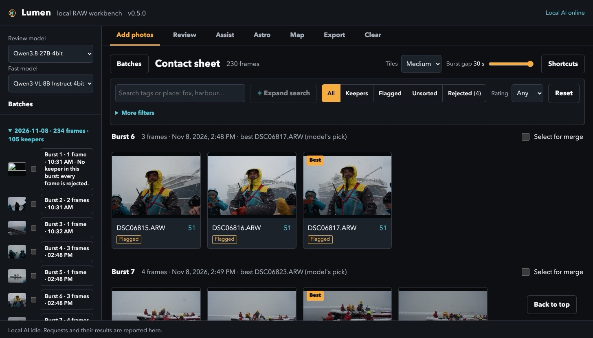

#  Lumen

**Website: [lumen.contact](https://lumen.contact)**

**It turns 5,000 photos from a trip into the 50 worth showing anyone, without
looking at every single one.**

**New in 0.6: the AI runs where you are.** On this Mac in the field with no
connection, on your own PC at home, or on an online service you hold a key
for. One select switches between them; see
[Settings and the AI engine](#settings-and-the-ai-engine).

> When I'm photographing wildlife I hold the button down and the camera takes a
> burst, ten or twenty almost identical shots in a couple of seconds. After a
> trip I come home with thousands of them. Lumen sorts them for me. It puts each
> burst together, shows me which shot is sharpest with the eyes open, and lets me
> keep that one and bin the rest with a single key. Then it does the boring
> jobs: it works out where each photo was taken, puts them on a map, labels
> what's in them, and saves copies ready to share. It all runs on my own Mac, so
> nothing gets uploaded unless I choose to, and it never changes the original photos.
>
> — Nasir David

The Python package is `lumen-raw` and the command is `lumen`.

Lumen is a local, non-destructive RAW photography workbench for Apple
Silicon Macs. It catalogs Sony `.ARW`, Leica `.DNG`, Nikon `.NEF` and Canon `.CR2`/`.CR3` raws (and a Sony body's own JPEGs) without moving or changing them,
extracts previews, groups bursts, explains a best-shot choice, optionally tags
previews through oMLX, writes portable sidecars, shows where the frames were
taken on an offline map, checks astrophotography frames, and hands exports to
local tools such as darktable. Fujifilm raws are not supported yet.

Lumen runs on any Apple Silicon Mac with 16 GB of memory using one oMLX
model, the fast vision model (`Qwen3-VL-8B-Instruct-4bit`, about 6 GB loaded),
which covers every job: tagging, problem scans, astro triage, critique,
captions, digests, composition advice, and develop suggestions. With more
memory, such as the 48 GB M4 it was built on, add the review model
(`Qwen3.8-27B-4bit`, about 16 GB loaded) for closer reads of a frame and bolder
develop advice, and keep it loaded for whatever else you use oMLX for, such as
its chat. **Review model** and **Fast model** dropdowns at the top of the left rail move
either role between the two while Lumen runs (see
[Choosing the models](docs/GUIDE.md#choosing-the-models)).

The same laptop works three ways, switched from one select at the top of the
left rail. In the field the advice runs on **This Mac**, with no connection at
all. At home it can run on **Base**, your own computer with a bigger graphics
card (LM Studio or Ollama on a PC, say), so the frames stay on your own
network and the Mac needs no model loaded. With good internet it can run on
**Online**, a service you hold a key for, which felt quick when tried (no times recorded yet)
and is the one where resized previews leave your network. Nothing else about the
workflow changes. See
[Settings and the AI engine](#settings-and-the-ai-engine).

Install below; the workflow is in [docs/GUIDE.md](docs/GUIDE.md).



[Watch the walkthrough](docs/media/walkthrough.mp4) (MP4, 1.4 MB): a cheetah
burst culled from the keyboard, a frame opened for crop and develop advice,
then the map of a South Georgia shoot and the Export tab. More screenshots are
in [docs/GUIDE.md](docs/GUIDE.md).

To try it without a Sony camera, import the two sample `.ARW` frames in
[`Examples/`](Examples/) (see [First run](#first-run)).

## Why Lumen exists

I shoot nature and wildlife, often on trips to places like the South African
bush and Antarctica, and come home with thousands of RAW frames per day from a
Sony body that fires long bursts. Nothing I tried fit how that work actually
goes:

- **Volume first.** A day's cull has to be fast: load a card, see every burst
  as one row, keep the one frame that matters, reject the rest with a single
  key, and move on. Lumen groups bursts, splits near-duplicates, measures
  sharpness, exposure, and eye/face quality, and explains why it proposes a
  pick. The pick is advice; my choice always wins. Regrouping is keyboard
  work too: `G` marks bursts to merge, and `B` points a stray frame at the
  nearby bursts it most looks like.
- **Originals are sacred.** Years of RAW files are the archive. Lumen never
  moves, renames, or writes into them; everything it makes lives in its own
  library and can be thrown away.
- **Rich metadata without typing.** Capture time, camera, lens, GPS, and a
  real place name ("Neko Harbour, Antarctica") land in the catalog and in
  portable sidecars, so the frames stay searchable years later in any tool.
- **Travel-safe ingest.** Cards get copied to a primary disk and a mirror and
  every byte is verified before I am told it is safe to format.
- **Where was I.** A Map tab draws the frames over an offline Natural Earth
  base map with named terrain, seas and peaks, clusters them when they crowd,
  and takes a phone's GPX track to place the frames the camera could not fix.
  Nothing goes online unless I ask for one area's detail by hand.
- **Easy export.** One click from a kept frame to a full-resolution JPEG for
  print, a 2048 px version for sharing, or a web version with a watermark.
  Shoot JPEG in the body instead and the full export is the camera's own file,
  byte for byte, with the caption and keywords written in.
- **AI where there is no internet, and more of it where there is.** Lodges,
  ships, and field camps have no or painfully slow connections, and I do not
  want my frames uploaded anywhere. Tagging, caption drafts, problem scans,
  burst critique, day digests, and a one-job pass that picks and proposes
  develop settings for every burst run on local models through oMLX on the
  same Mac, offline, and only suggest. Back home the same laptop can send
  that advice to my own PC, which is faster and still private, or to an
  online service when I would rather have the speed; it says which while it
  does, and asks before a batch goes.
- **Night skies too.** Long trips mean dark skies, so sky-frame triage and a
  reproducible Siril stack live in the same tool, followed by a debrief that
  reads the frames' EXIF and Siril's log and says what to change next night.
- **Accessible and keyboard-driven.** Native controls, live announcements, and
  full keyboard operation are part of the design, not an afterthought.

It is a personal tool built for one photographer's workflow and shared as is
by Jahan Interactive Pty Ltd under the [MIT License](LICENSE). Fixes are welcome; see
[CONTRIBUTING.md](CONTRIBUTING.md), and [SECURITY.md](SECURITY.md) for
reporting anything sensitive. Versions are listed in [CHANGELOG.md](CHANGELOG.md).

## Install

Prerequisites: macOS 13.5 or newer on an Apple Silicon Mac with at least 16 GB
of memory (AI advice on this Mac needs macOS 15). Lumen was built and measured on a
48 GB M4. The app was installed and used on a 16 GB M4 Mac mini; AI on a Mac
that size takes the fast model only (about 6 GB), with the notes in the guide's
[Local AI](docs/GUIDE.md#on-a-16-gb-mac).

There are two ways in: the app, for photographers who would rather not use a
terminal, and the project folder, for those who would.

### The app

`Lumen.app` carries everything Lumen needs to import, cull, develop and export,
in about 80 MB; nothing else has to be installed first and Terminal is never
needed. **[Download Lumen for Mac](https://github.com/jahaninteractive/lumen/releases/latest/download/Lumen-latest.dmg)**
(a 40 MB disk image, signed and notarized; every version is on the
[releases page](https://github.com/jahaninteractive/lumen/releases)).

1. Open the disk image. It holds Lumen and a shortcut to Applications.
2. Open Lumen and choose **Move** when it asks "Move Lumen to your Applications
   folder?". It copies itself there and opens the copy; dragging it onto
   Applications works too.
3. The first launch shows **Welcome to Lumen**. Lumen is ready to use already;
   the window lists four optional extras with their sizes: Places (place
   names, about 50 MB; **Add a country…** picks the countries you photograph
   in by name, which adds their parks, reserves and bays), Map (about 100 MB),
   darktable (310 MB, for refined previews and exports that use a darktable
   profile or start from a PNG, TIFF or HEIC; raws and camera JPEGs export
   without it) and Siril (230 MB, for night-sky stacking). Tick what you want
   and press **Install**, or **Open Lumen** to skip. An install ends with
   "Finished. Press Open Lumen to start."; anything that did not finish is
   listed, and pressing Install again picks it up.
4. Lumen opens in your web browser: its window is a browser tab, and the app
   in the Dock keeps it running. Closing the tab does not stop it; click Lumen
   in the Dock to open it again, and quit Lumen from the Dock to stop it.
5. Right-click Lumen's Dock icon for **Open Lumen**, **Set Up Lumen…** (add an
   extra later) and **Uninstall Lumen…**. The same items are in the Lumen menu.
6. For AI advice, open **Settings** (the gear at the far right of the tabs) and
   connect a service under AI engine: Base (your own computer at home) or
   Online (a service you hold a key for); see
   [Settings and the AI engine](#settings-and-the-ai-engine). The app does not
   install AI on this Mac; to run it here, install oMLX yourself and follow
   [Local AI](docs/GUIDE.md#local-ai).

The guide's [Install the app](docs/GUIDE.md#install-the-app) has the same steps
in more detail, with updating and what was found on a 16 GB Mac.

**Uninstall Lumen…** always moves the downloaded extras and the app itself to
the Trash, and removes any saved service keys from your Keychain; those cannot
be recovered, so keep a copy of a key you will need again. Your library (`~/Pictures/Lumen
Library`) is kept unless you tick its boxes: one for Lumen's working data
(ratings, picks, tags, crops, develop settings and previews), one for your
exported files. Leave them off and a later reinstall finds the library again.
Your camera originals are never touched, and oMLX and its
models are left alone. Everything else goes to the Trash, so a mistake can be
put back.

There are no automatic updates: a new version is a new disk image, and Move
replaces the old copy while the library and the extras stay.

If a Lumen is already running from the project folder on the usual address,
the app says so and opens that one instead of starting a second.

### From the project folder

Homebrew is needed only if `uv` or ExifTool is missing. From this project
folder:

```sh
zsh scripts/bootstrap.sh
uv run lumen doctor
```

The bootstrap gets a fresh clone to a working `lumen doctor`, skipping anything
already in place, so it is safe to re-run:

1. checks the platform, `brew install`s `uv` and ExifTool if either is missing,
   and starts the Apple command-line tools installer if they are not present
   (re-run it when that dialog finishes);
2. creates the private Python environment and compiles the two macOS helpers
   into `~/Pictures/Lumen Library/cache/bin` (set `LUMEN_LIBRARY` first if the
   library should live elsewhere);
3. downloads GeoNames (`countryInfo.txt`, `readme.txt`, `cities500`) into
   `vendor/data/geonames/` and asks which country files you want
   (`LUMEN_GEONAMES_COUNTRIES="ZA AQ"` answers without asking), and the eleven
   Natural Earth layers for the Map tab (about 100 MB, pinned commit and
   SHA-256s) into `vendor/data/map/`;
4. downloads darktable 5.6.2 and Siril 1.4.4, checks each disk image against a
   pinned SHA-256, and copies the apps into `vendor/apps/`;
5. on macOS 15 or newer, offers to copy oMLX 0.7.2 into `/Applications` (open
   it once afterwards: it installs its `omlx` command), then offers the fast
   model `Qwen3-VL-8B-Instruct-4bit` (6 GB) and the review model
   `Qwen3.8-27B-4bit` (16 GB, offered by default from 32 GB of memory) into
   oMLX's model folder, or `~/Models` before oMLX has settings.

`--yes` accepts every default without asking (also the behaviour when stdin
is not a terminal). `--no-download` does only the checks, the Python sync and
the compiles: install `uv`, ExifTool and the
command-line tools yourself (`brew install uv exiftool`, `xcode-select
--install`) and fill `vendor/` by hand as below. The closing lines name
anything that was skipped and how to get it later.

## The `vendor/` folder

Everything under `vendor/` is ignored by Git, so a fresh clone starts without
it and nothing in it is ever committed. It holds the optional tools and data
that Lumen looks for locally:

| Path | What goes there | Used by |
|------|-----------------|---------|
| `vendor/apps/darktable.app` | the darktable application bundle; Lumen runs `Contents/MacOS/darktable-cli` | refined previews, exports that use a darktable profile or start from a PNG, TIFF or HEIC, RAW preview fallback |
| `vendor/apps/Siril.app` | the Siril application bundle; Lumen runs `Contents/MacOS/siril-cli` | Astro stacking |
| `vendor/data/geonames/` | GeoNames `<CC>.txt`, `cities500.txt`, `countryInfo.txt` | Places (see below) |
| `vendor/data/map/` | eleven Natural Earth 1:10m GeoJSON layers (`LUMEN_MAP_DIR`) | Map tab base map |
| `vendor/downloads/` | installers you keep around (`.dmg`, `.zip`); Lumen never reads it | nothing |

Tool discovery checks `PATH` first and then the project-local bundle, and
refuses a bundle executable that resolves outside its `.app`. `uv run lumen
doctor --json` prints the exact path each tool resolved to under `tools`.
Installing into `/Applications` works too; add the bundle's `Contents/MacOS`
folder to `PATH` if the installer does not. ExifTool is not vendored: it comes
from Homebrew and is required.

The bootstrap fills these. To do it by hand (`--no-download`):

- **darktable** (optional, 5.6.2 verified): download the Apple Silicon disk
  image from <https://www.darktable.org/install/>, open it, and drag
  `darktable.app` into `vendor/apps/`. Exports keep EXIF and GPS, so Lumen pins
  darktable's metadata flags regardless of your darktable preferences.
- **Siril** (optional, 1.4.4 verified): download the Apple Silicon build from
  <https://siril.org/download/> and drag `Siril.app` into `vendor/apps/`. The
  managed stacking workflow is validated against Siril 1.4.x only
  (`lumen doctor` reports `supported`); other versions can still run reviewed
  scripts through the legacy hook below.
- **GeoNames** (optional, needed for place names): see [Places](docs/GUIDE.md#places) for
  which files to download.
- **Natural Earth** (optional, needed for the Map tab's base map): the layer
  names and the pinned commit are in `scripts/bootstrap.sh`; put the
  `.geojson` files directly in `vendor/data/map/`. See [Map](docs/GUIDE.md#map).

## First run

In the app, Lumen opens in the browser by itself, and the **Add photos** tab takes a
card or folder.
The commands below are for the project folder.

Check the machine:

```sh
uv run lumen doctor
```

Import a card or folder. Originals stay in place:

```sh
uv run lumen import "/Volumes/PHOTO_CARD/DCIM"
```

No card to hand? `Examples/` holds two Sony `.ARW` frames to try it on:

```sh
uv run lumen import Examples
```

Sony `.ARW`, Leica `.DNG`, Nikon `.NEF` and Canon `.CR2`/`.CR3` raws, and a Sony body's own JPEGs,
are the sources Lumen is built for; the guide lists [the bodies measured so
far](docs/GUIDE.md#cameras-measured). Phone
photos should be imported as HEIC, not as JPEGs exported from Photos; see
[the guide](docs/GUIDE.md#what-is-working).

Open the local UI:

```sh
uv run lumen serve --open
```

The server listens only on `127.0.0.1:8765`. To use another library:

```sh
uv run lumen --library "/Volumes/Photo Catalog/Lumen" serve --open
```

The header reports tool health ("Local AI online" or "Local AI offline", or
"AI: Base" or "AI: Online" when Settings has switched the AI engine, then
"<tool> missing" for each unavailable tool), and reports first when the
running server is older than the files on disk: the browser is served fresh
from disk on every request while the Python stays as it was imported, so an
edit after startup otherwise leaves a stale server looking current and failing
as whatever validation error fires first. Restart `lumen serve` and reload when
you see it. Checking out a different revision without changing content does not
trip it.

## Workflow at a glance

Each step is a section of [docs/GUIDE.md](docs/GUIDE.md):

- [Ingest a card](docs/GUIDE.md#ingest-a-card): copy to a primary and a
  mirror, verify every byte, then import. Or
  [import](docs/GUIDE.md#ingest-or-import) frames already on a drive.
- [Cull](docs/GUIDE.md#cull): bursts as rows, one key per decision, an
  explained best-shot proposal you can override.
- [Frame view](docs/GUIDE.md#frame-view): full-size check, crop, develop,
  EXIF, keywords, caption, and place in one dialog.
- [Filters and paging](docs/GUIDE.md#filters-and-paging), and
  [Places](docs/GUIDE.md#places): offline place names from GeoNames, typed
  GPS for frames without a fix.
- [Map](docs/GUIDE.md#map): frames over an offline base map, GPX tracks,
  geotagging along a track, and frames from earlier imports.
- [Local AI](docs/GUIDE.md#local-ai): tags, problem scan, captions, burst
  critique, digests, develop suggestions, and a pick-and-develop pass over
  every burst through oMLX, all advisory.
- [Settings and the AI engine](#settings-and-the-ai-engine): saved settings,
  and running the advice on this Mac, a Base server or an Online service.
- [Finish and clear a shoot](docs/GUIDE.md#finish-and-clear-a-shoot): crop,
  export presets, and recoverable removal.
- [Refine previews](docs/GUIDE.md#refine-previews) and
  [Stack a night sky](docs/GUIDE.md#stack-a-night-sky), with its
  [debrief](docs/GUIDE.md#debrief).
- [Batch and automation commands](docs/GUIDE.md#batch-and-automation-commands),
  with the module map in [docs/ARCHITECTURE.md](docs/ARCHITECTURE.md).

## Settings and the AI engine

**Settings** is the gear button at the far right of the tab row. It opens in
place of the workflow panel, with four sections down its left side: AI engine,
Library, Places and map, and Server. Each section has its own **Save** and
**Discard**; nothing changes until you save, and each row says when a change
applies. A setting fixed by a shell variable (`LUMEN_NEAR_DUP_DISTANCE`,
`LUMEN_GEOCODE_ONLINE`) is shown read-only with the variable's name. Saved
settings are kept in the catalog and apply to the command line too. The Server
section shows the address, the version, and whether the running server is out
of date; it changes nothing.

### Where the advice runs

The AI engine section, and the **AI engine** select at the top of the left
rail, choose one of three engines for all advice:

- **This Mac** (the default): oMLX on this Mac, as described in
  [Local AI](docs/GUIDE.md#local-ai). No advice request leaves the Mac.
- **Base**: your own model server elsewhere on your network, at an `http` or
  `https` address, with an optional key.
- **Online**: an online service you hold a key for, at an `https` address.

Any server that speaks the standard chat completions API works. Type the
service's API address as its documentation gives it, path included; a bare
host gets `/v1`. Keys are kept in the macOS Keychain (service `Lumen`), never
shown again, and never sent to the page. **Test** saves the address and asks
the engine for its models; the Fast model and Review model fields offer what
it found, or take a typed name when the service lists none. Switching to an
engine that does not answer is refused and nothing is saved, and so is a
switch while a batch is still running. While Base or Online is in use, the
header status line begins "AI: Base" or "AI: Online", followed by the
session's tokens once it has made calls. A saved key belongs to the address it
was saved for: moving that engine to another host is refused until you
replace the key. To change service, press **Replace**, paste the new service's
key, then save the new address; a key replaced since Lumen started may follow
one change of address.

In the AI engine section, **Base setup** and **Online setup** fold away under
the engine choice, one open at a time. The chosen engine's setup opens by
itself; open the other to set it up without switching to it.

The Online form's **Service** select fills in a documented address; **Other**
leaves it for typing, and the address stays an ordinary field. The Base hint
gives the usual addresses of two home model servers.

| Engine | Service or program | Address |
|--------|--------------------|---------|
| Online | Anthropic | `https://api.anthropic.com/v1` (the service describes this chat-compatible address as a testing and comparison path; its native API is the supported one). Its model names fill the lists after **Test** |
| Online | Google | `https://generativelanguage.googleapis.com/v1beta/openai` |
| Online | OpenAI | `https://api.openai.com/v1` |
| Online | OpenRouter | `https://openrouter.ai/api/v1` (one key reaches many makers' models; names look like `maker/model`) |
| Online | Qwen (Alibaba Cloud) | no preset: choose **Other** and paste your workspace's address, `https://<WorkspaceId>.<region>.maas.aliyuncs.com/compatible-mode/v1`, from the service's console |
| Base | Ollama | `http://<your PC>:11434/v1` |
| Base | LM Studio | `http://<your PC>:1234/v1` |

Both remote engines have been run for real: Base against a home PC and
Online against one service. The guide has the times measured, how to set up a
home server (turn the model's reasoning off; keep to what fits in the graphics
card's memory), and which services have been tried:
[Setting up a Base server](docs/GUIDE.md#setting-up-a-base-server).

### What leaves the Mac

On Base and Online, and only there, each request sends:

- the preview the advice needs, resized to at most 1024 px on the long edge and
  re-encoded with no metadata (no EXIF, GPS position or serial number);
- the prompt, which can carry the frame's place name, your keyword
  vocabulary, develop settings and a summary of the histogram, and the words
  you type as feedback on a develop suggestion;
- for **Expand search**, the words you typed, with your keyword vocabulary;
- for the day digest, the day's date, its counts (frames, keepers, rejects,
  bursts, astro jobs), its keywords and place names, and the top frames' file
  names, scores and burst numbers;
- for a stack review, the debrief's text (what happened, what to try now,
  next time's settings) with the stacked preview.

Never sent: camera originals, source paths, fingerprints, GPS coordinates, and
oMLX's own key. The Base and Online keys go only to their own engine.
(Looking up missing place names online, in Places and map, is a separate
setting that sends a frame's coordinates to the place lookup service.)

Online services charge for tokens. Lumen counts the tokens each engine
reports for the running server, shown as "Tokens this session" in the AI
engine section with the input and output tokens and the number of calls (one
total per engine, not per model; the service's own console is where cost is
shown); a reply that reports none is counted as "not reported", and
the count starts again when the server restarts.

Batches ask first. On Base or Online, tagging, Tag, scan and caption, Pick and
develop every burst, the problem scan and sky triage say "This sends N frames
to Online. Continue?" before they start; the command-line `tag`, `assist`,
`review-rejects` and `triage` print the count and need `--yes`. Advice on one
frame or one burst runs without asking; the status line is the notice.

## Tests

```sh
uv run python -W error -m unittest discover -s tests -v
zsh scripts/smoke_test.sh
```

The HTTP tests bind an ephemeral loopback port. A locked-down CI sandbox must
allow `127.0.0.1` socket binding. The macOS Vision runtime also needs ordinary
user-session access to Apple's Vision model service.

## Safety and current limits

- Lumen never deletes, renames, moves, or writes into originals.
- Version one uses measured quality to shortlist; it does not claim to know the
  photographer's aesthetic preference. Manual picks are authoritative.
- Star counts and trailing warnings are screening signals, not scientific
  photometry.
- Managed stacking uses two fixed Siril recipes; per-job recipe editing and
  full historical one-click rollback are explicit extension points, not
  pretend-complete stubs.
- The web server is local-only and has no authentication; do not modify it to
  bind to a LAN address without adding authentication and transport security.
  The AI engine is a separate matter: on Base or Online, Lumen makes outgoing
  requests to that one address and still accepts none from outside.

## How it was built

Decisions were measured rather than guessed, and the measurements are in the
docs so they can be re-run:

- Model choice: three local vision models were timed and parsed on real
  frames before two were kept ([docs/MODELS.md](docs/MODELS.md)). The model
  that never returned develop settings in the required shape was dropped.
- Raw rendering: Core Image skips raw sharpening below half scale, so previews
  decode at native size and resample afterwards; a control whose two extremes
  differed by 0.0001 in mean luminance is deliberately not exposed
  ([AGENTS.md](AGENTS.md), Current tool state).
- Export metadata: darktable only keeps the MakerNote because of a pinned
  config flag, and IPTC is written by ExifTool because agency ingests still
  read it; both were found by inspecting real exports.
- Safety: originals are never written, the server binds to loopback only,
  mutation routes check origin and strict JSON, and tests pin those rules.
- Install: one script fetches every tool against a pinned hash; the manual
  route stays documented for air-gapped machines.

A frank assessment of where Lumen stands against commercial tools, and what
is still missing, is in [docs/ASSESSMENT.md](docs/ASSESSMENT.md).

## Licence and disclaimer

Lumen is released under the [MIT License](LICENSE). It is a personal tool
built for one photographer's workflow and is shared as is, in the hope that it
is useful to others.

The software is provided "as is", without warranty of any kind, express or
implied, including but not limited to the warranties of merchantability,
fitness for a particular purpose and noninfringement. In no event shall the
authors or copyright holders be liable for any claim, damages or other
liability, whether in an action of contract, tort or otherwise, arising from,
out of or in connection with the software or the use or other dealings in the
software.

Lumen never writes to, moves or deletes camera originals, but keep your own
backups: you are responsible for your photographs and for checking any export
before you rely on it. Optional tools Lumen can download or call (darktable,
Siril, ExifTool, oMLX and the local models) are separate projects under their
own licences.

The photographs in [`Examples/`](Examples/), `docs/images/` and `docs/media/`
are © Nasir David and are not covered by the MIT License; see
[`Examples/README.md`](Examples/README.md). Sony, Leica, Nikon, Canon, Apple, Mac and the other
product names mentioned are trademarks of their owners; Lumen is not
affiliated with or endorsed by any of them.
