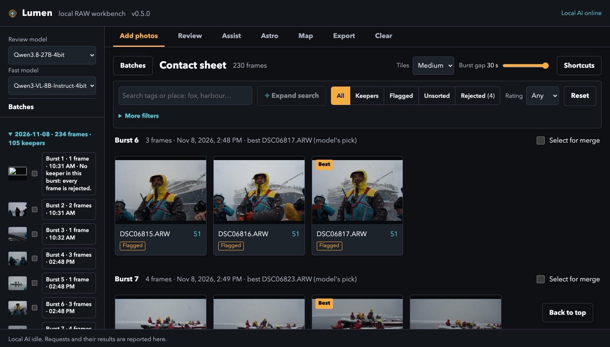

#  Lumen

The Python package is `lumen-raw` and the command is `lumen`.

Lumen is a fully local, non-destructive RAW photography workbench for Apple
Silicon Macs. It catalogs Sony `.ARW` files (and the camera's own JPEGs) without moving or changing them,
extracts previews, groups bursts, explains a best-shot choice, optionally tags
previews through oMLX, writes portable sidecars, shows where the frames were
taken on an offline map, checks astrophotography frames, and hands exports to
local tools such as darktable.

Lumen runs on any Apple Silicon Mac with 16 GB of memory using one oMLX
model, the fast vision model (`Qwen3-VL-8B-Instruct-4bit`, about 6 GB loaded),
which covers every job: tagging, problem scans, astro triage, critique,
captions, digests, composition advice, and develop suggestions. With more
memory, such as the 48 GB M4 it was built on, add the review model
(`Qwen3.8-27B-4bit`, about 16 GB loaded) for closer reads of a frame and bolder
develop advice, and keep it loaded for whatever else you use oMLX for, such as
its chat. **Review model** and **Fast model** dropdowns at the top of the left rail move
either role between the two while Lumen runs (see
[Choosing the models](docs/GUIDE.md#choosing-the-models)).

Install below; the workflow is in [docs/GUIDE.md](docs/GUIDE.md).



[Watch the walkthrough](docs/media/walkthrough.mp4) (MP4, 1.4 MB): a cheetah
burst culled from the keyboard, a frame opened for crop and develop advice,
then the map of a South Georgia shoot and the Export tab. More screenshots are
in [docs/GUIDE.md](docs/GUIDE.md).

To try it without a Sony camera, download the two sample `.ARW` frames attached
to the [latest release](https://github.com/jahaninteractive/lumen/releases/latest)
and import their folder (see [First run](#first-run)).

## Why Lumen exists

I shoot nature and wildlife, often on trips to places like the South African
bush and Antarctica, and come home with thousands of RAW frames per day from a
Sony body that fires long bursts. Nothing I tried fit how that work actually
goes:

- **Volume first.** A day's cull has to be fast: load a card, see every burst
  as one row, keep the one frame that matters, reject the rest with a single
  key, and move on. Lumen groups bursts, splits near-duplicates, measures
  sharpness, exposure, and eye/face quality, and explains why it proposes a
  pick. The pick is advice; my choice always wins. Regrouping is keyboard
  work too: `G` marks bursts to merge, and `B` points a stray frame at the
  nearby bursts it most looks like.
- **Originals are sacred.** Years of RAW files are the archive. Lumen never
  moves, renames, or writes into them; everything it makes lives in its own
  library and can be thrown away.
- **Rich metadata without typing.** Capture time, camera, lens, GPS, and a
  real place name ("Neko Harbour, Antarctica") land in the catalog and in
  portable sidecars, so the frames stay searchable years later in any tool.
- **Travel-safe ingest.** Cards get copied to a primary disk and a mirror and
  every byte is verified before I am told it is safe to format.
- **Where was I.** A Map tab draws the frames over an offline Natural Earth
  base map with named terrain, seas and peaks, clusters them when they crowd,
  and takes a phone's GPX track to place the frames the camera could not fix.
  Nothing goes online unless I ask for one area's detail by hand.
- **Easy export.** One click from a kept frame to a full-resolution JPEG for
  print, a 2048 px version for sharing, or a web version with a watermark.
  Shoot JPEG in the body instead and the full export is the camera's own file,
  byte for byte, with the caption and keywords written in.
- **AI where there is no internet.** Lodges, ships, and field camps have no or
  painfully slow connections, and I do not want my frames uploaded anywhere.
  Tagging, caption drafts, problem scans, burst critique, day digests, and a
  one-job pass that picks and proposes develop settings for every burst run
  on local models through oMLX on the same Mac, offline, and only suggest.
- **Night skies too.** Long trips mean dark skies, so sky-frame triage and a
  reproducible Siril stack live in the same tool, followed by a debrief that
  reads the frames' EXIF and Siril's log and says what to change next night.
- **Accessible and keyboard-driven.** Native controls, live announcements, and
  full keyboard operation are part of the design, not an afterthought.

It is a personal tool built for one photographer's workflow and shared as is
by Jahan Interactive Pty Ltd under the [MIT License](LICENSE). Fixes are welcome; see
[CONTRIBUTING.md](CONTRIBUTING.md), and [SECURITY.md](SECURITY.md) for
reporting anything sensitive. Versions are listed in [CHANGELOG.md](CHANGELOG.md).

## Install

Prerequisites: macOS 13.5 or newer on an Apple Silicon Mac with at least 16 GB
of memory (the AI features need macOS 15). Lumen was built and measured on a
48 GB M4; a 16 GB machine has not been tested, but the fast model needs about
6 GB and nothing else in Lumen is memory-hungry. Homebrew is needed only if
`uv` or ExifTool is missing.

From this project folder:

```sh
zsh scripts/bootstrap.sh
uv run lumen doctor
```

The bootstrap gets a fresh clone to a working `lumen doctor`, skipping anything
already in place, so it is safe to re-run:

1. checks the platform, `brew install`s `uv` and ExifTool if either is missing,
   and starts the Apple command-line tools installer if they are not present
   (re-run it when that dialog finishes);
2. creates the private Python environment and compiles the two macOS helpers
   into `~/Pictures/Lumen Library/cache/bin` (set `LUMEN_LIBRARY` first if the
   library should live elsewhere);
3. downloads GeoNames (`countryInfo.txt`, `readme.txt`, `cities500`) into
   `vendor/data/geonames/` and asks which country files you want
   (`LUMEN_GEONAMES_COUNTRIES="ZA AQ"` answers without asking), and the eleven
   Natural Earth layers for the Map tab (about 100 MB, pinned commit and
   SHA-256s) into `vendor/data/map/`;
4. downloads darktable 5.6.2 and Siril 1.4.4, checks each disk image against a
   pinned SHA-256, and copies the apps into `vendor/apps/`;
5. on macOS 15 or newer, offers to copy oMLX 0.7.2 into `/Applications` (open
   it once afterwards: it installs its `omlx` command), then offers the fast
   model `Qwen3-VL-8B-Instruct-4bit` (6 GB) and the review model
   `Qwen3.8-27B-4bit` (16 GB, offered by default from 32 GB of memory) into
   oMLX's model folder, or `~/Models` before oMLX has settings.

`--yes` accepts every default without asking (also the behaviour when stdin
is not a terminal). `--no-download` does only the checks, the Python sync and
the compiles: install `uv`, ExifTool and the
command-line tools yourself (`brew install uv exiftool`, `xcode-select
--install`) and fill `vendor/` by hand as below. The closing lines name
anything that was skipped and how to get it later.

## The `vendor/` folder

Everything under `vendor/` is ignored by Git, so a fresh clone starts without
it and nothing in it is ever committed. It holds the optional tools and data
that Lumen looks for locally:

| Path | What goes there | Used by |
|------|-----------------|---------|
| `vendor/apps/darktable.app` | the darktable application bundle; Lumen runs `Contents/MacOS/darktable-cli` | JPEG export, refined previews, RAW preview fallback |
| `vendor/apps/Siril.app` | the Siril application bundle; Lumen runs `Contents/MacOS/siril-cli` | Astro stacking |
| `vendor/data/geonames/` | GeoNames `<CC>.txt`, `cities500.txt`, `countryInfo.txt` | Places (see below) |
| `vendor/data/map/` | eleven Natural Earth 1:10m GeoJSON layers (`LUMEN_MAP_DIR`) | Map tab base map |
| `vendor/downloads/` | installers you keep around (`.dmg`, `.zip`); Lumen never reads it | nothing |

Tool discovery checks `PATH` first and then the project-local bundle, and
refuses a bundle executable that resolves outside its `.app`. `uv run lumen
doctor --json` prints the exact path each tool resolved to under `tools`.
Installing into `/Applications` works too; add the bundle's `Contents/MacOS`
folder to `PATH` if the installer does not. ExifTool is not vendored: it comes
from Homebrew and is required.

The bootstrap fills these. To do it by hand (`--no-download`):

- **darktable** (optional, 5.6.2 verified): download the Apple Silicon disk
  image from <https://www.darktable.org/install/>, open it, and drag
  `darktable.app` into `vendor/apps/`. Exports keep EXIF and GPS, so Lumen pins
  darktable's metadata flags regardless of your darktable preferences.
- **Siril** (optional, 1.4.4 verified): download the Apple Silicon build from
  <https://siril.org/download/> and drag `Siril.app` into `vendor/apps/`. The
  managed stacking workflow is validated against Siril 1.4.x only
  (`lumen doctor` reports `supported`); other versions can still run reviewed
  scripts through the legacy hook below.
- **GeoNames** (optional, needed for place names): see [Places](docs/GUIDE.md#places) for
  which files to download.
- **Natural Earth** (optional, needed for the Map tab's base map): the layer
  names and the pinned commit are in `scripts/bootstrap.sh`; put the
  `.geojson` files directly in `vendor/data/map/`. See [Map](docs/GUIDE.md#map).

## First run

Check the machine:

```sh
uv run lumen doctor
```

Import a card or folder. Originals stay in place:

```sh
uv run lumen import "/Volumes/PHOTO_CARD/DCIM"
```

Sony `.ARW` and the body's own JPEGs are the sources Lumen is built for. Phone
photos should be imported as HEIC, not as JPEGs exported from Photos; see
[the guide](docs/GUIDE.md#what-is-working).

Open the local UI:

```sh
uv run lumen serve --open
```

The server listens only on `127.0.0.1:8765`. To use another library:

```sh
uv run lumen --library "/Volumes/Photo Catalog/Lumen" serve --open
```

The header reports tool health ("Local AI online" or "Local AI offline", then
"<tool> missing" for each unavailable tool), and reports first when the
running server is older than the files on disk: the browser is served fresh
from disk on every request while the Python stays as it was imported, so an
edit after startup otherwise leaves a stale server looking current and failing
as whatever validation error fires first. Restart `lumen serve` and reload when
you see it. Checking out a different revision without changing content does not
trip it.

## Workflow at a glance

Each step is a section of [docs/GUIDE.md](docs/GUIDE.md):

- [Ingest a card](docs/GUIDE.md#ingest-a-card): copy to a primary and a
  mirror, verify every byte, then import. Or
  [import](docs/GUIDE.md#ingest-or-import) frames already on a drive.
- [Cull](docs/GUIDE.md#cull): bursts as rows, one key per decision, an
  explained best-shot proposal you can override.
- [Frame view](docs/GUIDE.md#frame-view): full-size check, crop, develop,
  EXIF, keywords, caption, and place in one dialog.
- [Filters and paging](docs/GUIDE.md#filters-and-paging), and
  [Places](docs/GUIDE.md#places): offline place names from GeoNames, typed
  GPS for frames without a fix.
- [Map](docs/GUIDE.md#map): frames over an offline base map, GPX tracks,
  geotagging along a track, and frames from earlier imports.
- [Local AI](docs/GUIDE.md#local-ai): tags, problem scan, captions, burst
  critique, digests, develop suggestions, and a pick-and-develop pass over
  every burst through oMLX, all advisory.
- [Finish and clear a shoot](docs/GUIDE.md#finish-and-clear-a-shoot): crop,
  export presets, and recoverable removal.
- [Refine previews](docs/GUIDE.md#refine-previews) and
  [Stack a night sky](docs/GUIDE.md#stack-a-night-sky), with its
  [debrief](docs/GUIDE.md#debrief).
- [Batch and automation commands](docs/GUIDE.md#batch-and-automation-commands),
  with the module map in [docs/ARCHITECTURE.md](docs/ARCHITECTURE.md).

## Tests

```sh
uv run python -W error -m unittest discover -s tests -v
zsh scripts/smoke_test.sh
```

The HTTP tests bind an ephemeral loopback port. A locked-down CI sandbox must
allow `127.0.0.1` socket binding. The macOS Vision runtime also needs ordinary
user-session access to Apple's Vision model service.

## Safety and current limits

- Lumen never deletes, renames, moves, or writes into originals.
- Version one uses measured quality to shortlist; it does not claim to know the
  photographer's aesthetic preference. Manual picks are authoritative.
- Star counts and trailing warnings are screening signals, not scientific
  photometry.
- Managed stacking uses two fixed Siril recipes; per-job recipe editing and
  full historical one-click rollback are explicit extension points, not
  pretend-complete stubs.
- The web server is local-only and has no authentication; do not modify it to
  bind to a LAN address without adding authentication and transport security.

## How it was built

Decisions were measured rather than guessed, and the measurements are in the
docs so they can be re-run:

- Model choice: three local vision models were timed and parsed on real
  frames before two were kept ([docs/MODELS.md](docs/MODELS.md)). The model
  that never returned develop settings in the required shape was dropped.
- Raw rendering: Core Image skips raw sharpening below half scale, so previews
  decode at native size and resample afterwards; a control whose two extremes
  differed by 0.0001 in mean luminance is deliberately not exposed
  ([AGENTS.md](AGENTS.md), Current tool state).
- Export metadata: darktable only keeps the MakerNote because of a pinned
  config flag, and IPTC is written by ExifTool because agency ingests still
  read it; both were found by inspecting real exports.
- Safety: originals are never written, the server binds to loopback only,
  mutation routes check origin and strict JSON, and tests pin those rules.
- Install: one script fetches every tool against a pinned hash; the manual
  route stays documented for air-gapped machines.

A frank assessment of where Lumen stands against commercial tools, and what
is still missing, is in [docs/ASSESSMENT.md](docs/ASSESSMENT.md).
