# Lumen user guide

Website: [lumen.contact](https://lumen.contact), with a [step-by-step walk
through one real trip](https://lumen.contact/guide), [AI setup](https://lumen.contact/ai)
and an [install page](https://lumen.contact/install).

Everything a photographer does after install, in the order a shoot goes:
ingest, cull, frame view, places, map, local AI, settings, export, refine, stack. Installing
the app is just below; installing from the project folder and the first run
from the command line are in the [README](../README.md#install).

## Install the app

`Lumen.app` needs nothing else installed and never needs Terminal. It wants an
Apple Silicon Mac on macOS 13.5 or newer and about 80 MB for itself.
**[Download Lumen for Mac](https://github.com/jahaninteractive/lumen/releases/latest/download/Lumen-latest.dmg)**:
a 40 MB disk image, signed and notarized, so macOS asks only its usual
question about a download from the internet. Every version is on the
[releases page](https://github.com/jahaninteractive/lumen/releases). The
website's [install page](https://lumen.contact/install) shows the same steps
with a picture of the first window.

1. **Open the disk image.** It holds Lumen and a shortcut to Applications.
2. **Open Lumen.** From the disk image it asks "Move Lumen to your
   Applications folder?" Choose **Move**: it copies itself, opens the copy,
   and the disk image can be ejected. Dragging Lumen onto Applications by hand
   also works.
3. **Welcome to Lumen.** The first launch shows one window: "Lumen is ready to
   use. These extras are optional; choose any to download now, or add them
   later from the Lumen menu."

   | Extra | Size | What it adds |
   |-------|------|--------------|
   | Places | about 50 MB | Turns each photo's GPS position into a place name, on this Mac. Most people want this. **Add a country…** picks the countries you photograph in by name, which adds their parks, reserves and bays |
   | Map | about 100 MB | The world map behind the Map tab, with no internet connection. Most people want this |
   | darktable | 310 MB | A free raw editor Lumen uses for refined previews, darktable looks, and exporting HEIC, PNG or TIFF photos. Raws and camera JPEGs export without it |
   | Siril | 230 MB | A free astronomy program, only for stacking night-sky frames |

   The bottom line shows the space needed and the space free; Lumen allows
   twice the listed size while installing, and warns first when there is not
   enough.
4. **Install**, or **Open Lumen** to skip. A progress bar runs and a log shows
   each download. It ends with "Finished. Press Open Lumen to start."
   Anything that did not finish is listed under "Not finished. Press Install
   to try again:", and Install picks it up.
5. **Lumen opens in your default browser.** That is normal: Lumen's window is
   a browser tab, and the app in the Dock is what keeps it running. The **Add
   photos** tab takes a card or folder.
6. **Privacy questions.** The first time Lumen reads photos, macOS asks
   whether it may open that folder or memory card. Lumen reads photos from
   those places and never changes the originals.
7. **Coming back.** Click Lumen in the Dock to open the tab again. Right-click
   the Dock icon for **Open Lumen**, **Set Up Lumen…** and **Uninstall
   Lumen…**; the same items, and **About Lumen**, are in the Lumen menu, but
   the menu bar belongs to the browser while the tab is in front.
8. **Adding extras later.** Set Up Lumen… shows what is installed. Countries
   already fetched read "Added: …"; new picks read "To add: …".
9. **Quitting.** Quit Lumen from the Dock or its menu; it asks first if a job
   is still running. The server stops, and the browser tab says "Lumen has
   stopped".
10. **AI advice.** The app does not install AI on this Mac. The quickest route
    is Base or Online: open [Settings](#settings-and-the-ai-engine), choose
    the engine under AI engine, paste the key and press **Test**. To run the
    advice on this Mac, install oMLX yourself; see [Local AI](#local-ai) and
    [On a 16 GB Mac](#on-a-16-gb-mac).

**Updating.** There are no automatic updates. A new version is a new disk
image: open it and choose Move again, which replaces the old copy. The library
and the downloaded extras stay.

**Uninstall Lumen…** moves the downloaded extras and the app to the Trash and
removes saved service keys from the Keychain, which cannot be undone. The library stays unless you tick one or both of its boxes:
Lumen's working data (ratings, picks, tags, crops, develop settings, previews)
and your exported files. Leave both off and a later reinstall finds the
library again, with every rating and edit. Camera originals are never touched; oMLX and its
models are left alone, so remove oMLX separately. It ends with "Lumen was
uninstalled."; everything is in the Trash, so nothing is lost until it is
emptied.

Not yet tried in the app: night-sky stacking with Siril, the "Not enough free
space" warning, an update over an existing copy, and a first launch with no
internet connection.

## What is working

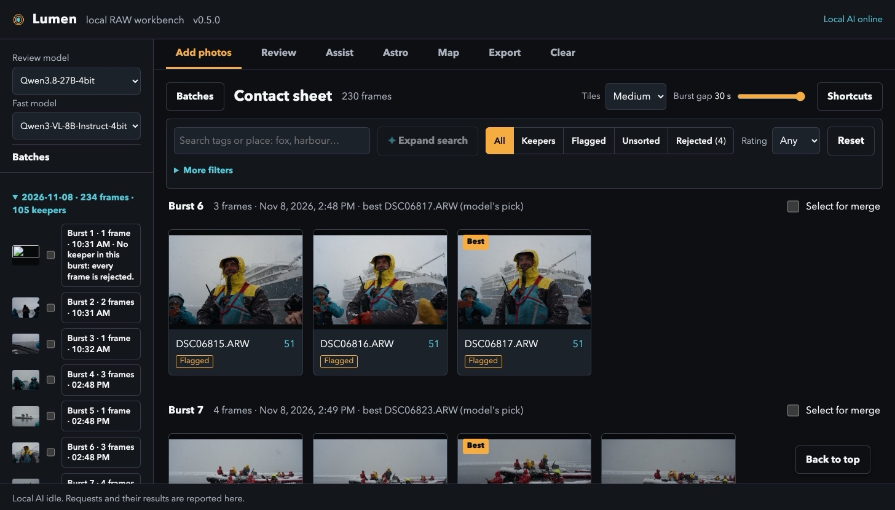

- Recursive import of Sony `.ARW`, Leica `.DNG`, Nikon `.NEF` and Canon `.CR2`/`.CR3` raws, and of
  JPEG, PNG, TIFF, and HEIC (the bodies measured are listed under
  [Cameras measured](#cameras-measured); Fujifilm raws are not
  supported yet). A JPEG straight from
  the camera is a first-class source: shoot JPEG in the body for its own
  rendering (Creative Look, lens corrections, noise handling) and cull, crop,
  tag, and export it as usual; only the Develop tab, which drives the raw
  decoder, stays raw-only. "Camera JPEG" means the Sony body's own file,
  which carries no colour profile and is taken as sRGB; a JPEG the body wrote
  in AdobeRGB is refused at export. Phone photos should come in as **HEIC**
  (in Photos, File > Export > Export Unmodified Original): the HEIC keeps its
  Display P3 profile and exports through darktable, which converts it to sRGB.
  A JPEG exported from Photos carries the same Display P3 colour but can lack
  the profile, and Lumen then refuses it as "not sRGB" rather than guess.
- Previews from the raw's own embedded JPEG through ExifTool, taking the first
  one at least 1000 px long; a raw without one (older Leica M bodies) is
  rendered from the raw by the macOS raw decoder instead, with `sips` and
  darktable behind it.
- Deterministic burst grouping by camera and capture time, 2 s apart by
  default, with a saved slider from 0.5 to 30 s that regroups the catalog.
- Regrouping from the keyboard: `G` / `Shift`+`G` mark bursts for merge, and
  `B` ("Belongs with…") suggests the nearby bursts a stray frame most
  resembles, by macOS Vision image feature print, and moves it on request.
- Explainable best-shot scoring from sharpness, exposure, and optional macOS
  Vision face/eye quality.
- Approximate sky background, highlight clipping, star count, and trailing
  checks for astrophotography frames.
- Local oMLX image tagging using the standard chat-completions vision request format,
  against a photographer-owned keyword vocabulary that learns from the model.
- One-button local AI assist for keepers: tags, a problem scan with suggested
  rejects, and a draft caption plus alt text, all advisory and skipped when
  already done.
- Burst critique (which frame is best and why), per-day digests, and sky-frame
  triage from the local models; none of them pick, reject, or exclude for you.
- One job that asks the review model to name the best frame of every burst,
  sets it as the pick, and parks suggested develop settings on it, skipping
  bursts already done and never undoing a frame you chose by hand.
- A Map tab: frames with a position over an offline Natural Earth base map
  with terrain, sea and peak names, clustered when they crowd, with GPX and
  GeoJSON overlays, geotagging along a track, three map styles, and frames
  from earlier imports read from the trash snapshots.
- GPS location read from the original and kept in the catalog and Full exports,
  resolved offline to a place name and country from a local GeoNames index.
  Frames without GPS take a position you type (a ship's display, a map), and a
  typed position stays editable; the camera's own fix is never changed.
- Verified card ingest (SHA-256 on every copy, optional mirror) before import.
- Near-duplicate clusters inside a burst from a perceptual difference hash.
- 480 px thumbnail tier for the contact sheet, with Small/Medium/Large tiles.
- A frame view (Enter on any frame) that gathers the full-size image, decisions,
  scores, place, keywords, caption, and crops in one dialog with Frame, Crop, Develop, and EXIF tabs.
- Non-destructive crop suggestions with optional local oMLX composition advice,
  plus your own drawn crop with an aspect lock; the contact-sheet tile shows the
  chosen crop, as export will.
- Typed keywords that survive re-tagging, and place correction for one frame,
  a whole burst, every frame within a radius you choose, or every frame from the
  same day that has no GPS, optionally remembered for nearby frames.
- Non-destructive develop controls (brightness, white balance, contrast,
  sharpness, clarity, lens correction, noise reduction, tone curve) that show
  on the sheet and are baked into exported JPEGs.
- SQLite catalog plus atomic JSON and XMP sidecars under the Lumen library.
- sRGB JPEG export for the current photo, all keepers, or the frames the contact sheet filters show, with Full (quality 92,
  full resolution; lossless for a camera JPEG), Share (2048 px), and Web (1600 px) presets, optional
  watermark and darktable XMP profile; the keepers export runs as a cancellable
  background job with a progress dialog. Each frame lands in a subfolder named
  for the date it was taken, and every export carries the camera's MakerNote
  plus IPTC caption and keywords alongside the EXIF and XMP. A failed frame's
  reason (a full disk is named as one) goes in the job log, and the **Export
  failed** filter lists those frames so you can retry just them.
- A status bar that says when the running server is older than the files on
  disk, so a stale `lumen serve` cannot look current.
- Guided, reproducible Siril stacking of a confirmed night-sky batch with
  optional darks/flats/biases, progress, cancellation, and retained job logs,
  followed by a rules-based debrief (what happened, what to try now, settings
  for next time) and an auto-stretched preview of the stack.
- Recoverable batch removal and workspace clearing that retain completed exports.
- Keyboard-friendly local contact-sheet UI and JSON-capable CLI.

### Cameras measured

Leica, Nikon and Canon raws go through the same import, cull, develop and export as
Sony ones. These bodies were imported, developed and exported for real from
one sample file each (2026-11-22):

| Body | File | Preview | Develop controls |
|---|---|---|---|
| Sony A7C II | `.ARW` | camera's 1616 px JPEG | all |
| Leica M9 | `.DNG` | rendered from the raw | all; no lens profile |
| Leica M (Typ 240) | `.DNG` | rendered from the raw | all; no lens profile |
| Leica M11 | `.DNG` | camera's 2112 px JPEG | all; no lens profile |
| Leica M11 Monochrom | `.DNG` | camera's 2112 px JPEG | no contrast, sharpness or noise reduction |
| Leica Q3 | `.DNG` | 1620 px embedded JPEG | all, lens correction on by default |
| Nikon D800 (uncompressed) | `.NEF` | camera's 1632 px JPEG | all; no lens profile |
| Nikon Z 8 (high-efficiency) | `.NEF` | camera's 1620 px JPEG | all, with lens correction |
| Nikon Z 9 (high-efficiency) | `.NEF` | camera's 1620 px JPEG | all, with lens correction |
| Canon EOS 5D Mark III | `.CR2` | camera's 5760 px JPEG | all; no lens profile |
| Canon EOS 5D Mark III (mRAW, sRAW) | `.CR2` | camera's 5760 px JPEG | no contrast, sharpness or noise reduction |
| Canon EOS R5 | `.CR3` | camera's 1620 px JPEG | all; no lens profile |
| Canon EOS R5 (compact raw, 1.6x crop) | `.CR3` | camera's 1620 px JPEG | all; no lens profile |

Every one exported a full-size JPEG carrying the camera's make, MakerNote and
IPTC caption and keywords. Things to know:

- **Develop controls a decoder lacks are greyed out.** The macOS raw decoder
  says per file which controls it offers. On the M11 Monochrom it offers no
  contrast, sharpness or noise reduction, so those sliders are disabled with
  "This file's decoder has no … control"; exposure, white balance, clarity and
  the tone curve still work (tint tones a monochrome frame). Lens Correction is
  disabled on any file with no lens profile.
- **Leica M bodies cannot read the lens's aperture.** The M11 and M11
  Monochrom record f/1 behind an f/2 lens; the M9 and M (Typ 240) record no
  aperture at all. The EXIF tab and the astro file name show what the file
  says. The M9's serial is masked in the file, so its frames group as one
  "unknown" body.
- **Leica M positions.** The M (Typ 240) and M11 write a position of 0°N 0°E
  when no phone is paired; Lumen treats that as no position, so those frames
  take a typed one like any other without GPS.
- **High-efficiency Nikon raws** (both Z samples) cannot be decoded
  by darktable, so **Refine previews** and exports with a darktable XMP profile
  are unavailable for them, and the frame view says so. Culling, Develop and
  JPEG export are unaffected, because they use the macOS decoder.
- **Canon reduced-size raws.** An mRAW or sRAW `.CR2` is decoded without
  contrast, sharpness or noise reduction, so those sliders are disabled as on
  the M11 Monochrom. The camera still embeds a JPEG at the sensor's full 5760 px,
  so the frame view's Full size is larger than the raw; Develop's Full size and
  the export are the raw's own 3960 or 2880 px. darktable decodes every Canon
  sample, the compact `.CR3` included, so none carries a warning. Both bodies
  were shot with lenses that carry no profile, so Lens Correction was
  never on offer.
- **Develop speed** (warm, on a 48 GB M4 Max, the window-sized render the tab asks
  for, about 1400 px): a 60 MP M11 frame took 0.8 s, a Z 9 frame 0.36 s and a
  33 MP Sony frame 0.31 s. **Full size** renders the whole raw: 1.4 s, 0.77 s
  and 0.49 s. A 45 MP EOS R5 frame took 0.53 s and 0.83 s. The first render of a 60 MP frame after a pause is slower: 5 to 10 s
  was seen on the M11.

Not yet tried: a Leica Q file straight from the camera (the Q3 sample had been
re-saved by Lightroom, so its embedded JPEGs are Lightroom's), an SL file, a
lossless-compressed Nikon Z file, a Canon RF lens with built-in corrections,
a Dual Pixel or HDR PQ Canon raw, and an astro stack from any of the three makers. Any of
them may behave differently; DNGs from phones or converters will import but
were not measured.


## Ingest or import?

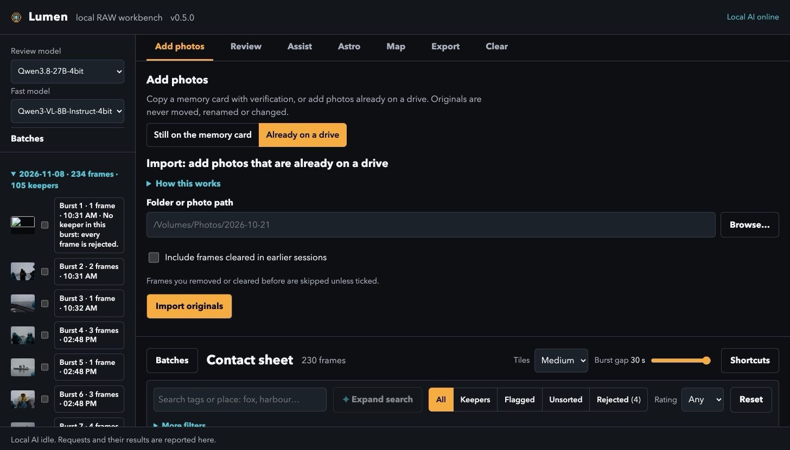

- **Ingest** is for a memory card that is still the only copy. It copies every
  file to a primary folder and an optional mirror on a second drive, reads each
  copy back and compares its SHA-256 checksum with the card, then imports the
  verified primary copies. The card is only read.
- **Import** is for photos already on a drive. Lumen reads them where they are
  and adds them to the catalog; nothing is copied or moved. The drive must be
  plugged in to export or refine previews.

Both live in the **Add photos** tab, which asks where the photos are: **Still on
the memory card** (Ingest) or **Already on a drive** (Import). A fresh visit
opens this tab when the catalog is empty; once it has frames the page opens with
the panel folded so the contact sheet leads.

## Ingest a card

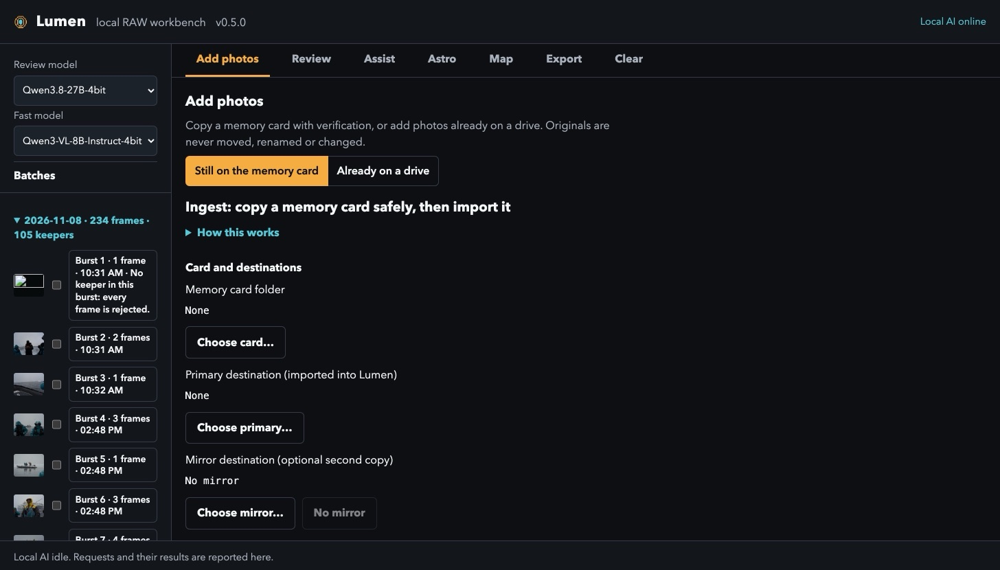

```sh
uv run lumen ingest "/Volumes/PHOTO_CARD" --to "/Volumes/Travel SSD/2026-10" --mirror "/Volumes/Backup/2026-10"
```

In the UI, open **Add photos**, choose **Still on the memory card**, choose the card, primary, and optional
mirror folders, and start. The panel ends with one of two verdicts:
*Every file verified on every destination.* or *Do not format the card: N files
were not verified.* The CLI exits 0 only in the first case. Never format a card
until every file is verified on every destination.

Each run writes `<library>/outputs/ingest/<job-id>/manifest.json` and
`ingest.log`. After a verified import, a catalog snapshot is saved beside the
primary originals in `lumen-catalog-backups/<UTC-timestamp>.sqlite3`. Rerunning
the same ingest skips files that are already present and verified.

Import and ingest skip frames you removed or cleared in an earlier session
(matched by content, and still copied and verified by ingest) and report them as
*previously cleared*. To bring them back on purpose, tick **Include frames
cleared in earlier sessions** under **Already on a drive** in Add photos or pass
`lumen import --include-cleared`. They come back with their earlier work,
including the bursts you merged, split or moved frames between.

## Jobs

Import, ingest, tag-all, preview refinement, and astro stacks run as background
jobs, one at a time. The web page shows progress in the footer strip at the
bottom, under the AI activity line, with a **Cancel job** button, which becomes **Clear** once the job has ended. From the CLI:

```sh
uv run lumen jobs --json
uv run lumen cancel 12 --json
```

While `lumen serve` is running it owns the job runner; job commands from a
second CLI process exit 2 and say the catalog is in use. Stop the server or use
the web page.

## Cull

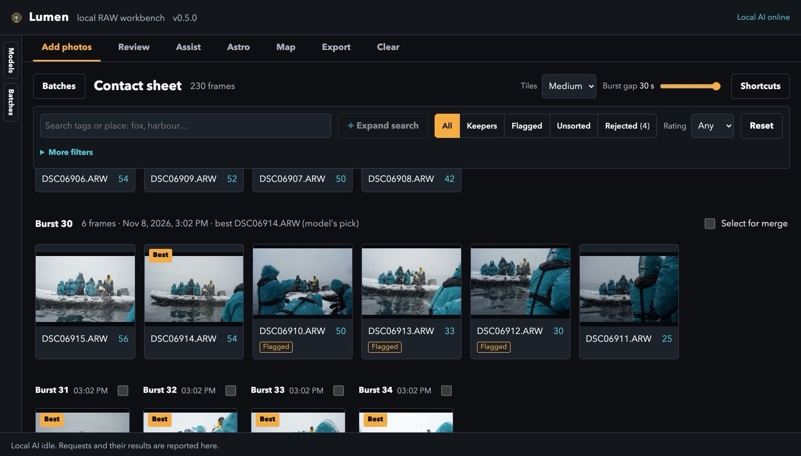

Bursts are frames from one camera less than the **Burst gap** apart, 2 s by
default. The slider beside **Tiles** moves it from 0.5 to 30 s; releasing it
regroups every burst in the catalog at the new gap and announces the count.
The gap is saved with the catalog, so imports and restarts keep it, and
regrouping is the same pass an import runs: your merges, splits and hand picks
survive it, and near-duplicate splitting still applies inside a burst. Widen
it for slow sequences (a bird working a perch, a ship's bow coming round);
narrow it when unrelated frames land together.

Merges and splits also run from the CLI. `merge` takes group IDs from
`lumen groups` and folds them into the earliest (long-exposure astro lights,
for example); `split` takes a photo ID:

```sh
uv run lumen merge 12 13 14
uv run lumen split 42
```

Each frame can be flagged, rejected, or cleared, and rated 0 to 5 stars.
Rejecting is a decision, never a deletion. From the CLI:

```sh
uv run lumen decide 42 --flag      # or --reject, --clear
uv run lumen rate 42 4             # 0 clears the rating
```

In the contact sheet, with a frame focused (**Shortcuts** lists these):

- Arrow keys move between frames; Up/Down and Page Up/Page Down move by row;
  Home and End jump to the first or last frame.
- `P` chooses the frame as best in its burst; `R` keeps it and rejects every
  other frame of the burst; `X` rejects; `F` flags; `U` clears the decision;
  `0`–`5` set the rating.
- `C` marks or unmarks a frame for compare (two at most); **Compare marked** opens
  both at 100 percent with panes that pan together.
- `G` marks or unmarks the focused frame's burst for merging (a cyan ring, and
  its **Select for merge** box ticks); `Shift`+`G` marks every burst from the
  last one marked to this one.
- `M` merges the batches ticked in the rail (the same as **Merge selected
  batches**); it works anywhere outside a text field.
- `B` opens **Belongs with…** under the focused frame (see below); `B` again,
  `Esc`, or moving to another burst closes it.
- `S` moves the focused frame out of its burst into one of its own. Like a
  merge, the split survives re-importing the folder; merge the bursts to undo it.
- `Enter` or `Space` opens the frame view (see below); `Esc` closes compare or the frame
  view.
- In the frame view, `[` and `]` (or the Left and Right arrows) step to the
  previous or next frame along the filmstrip, `Z` toggles full size, and the
  culling keys above keep working.

The **Tile size** select (Small/Medium/Large) is remembered by the browser, as
is the chosen tab. The left rail opens only the selected burst's day; days you
open by hand stay open across reloads, and a reload re-selects the last frame
you inspected.

A time burst is split further into near-duplicate clusters, each with its own
best pick, when a frame's difference hash is more than 12 bits from its
cluster's first frame. Set `LUMEN_NEAR_DUP_DISTANCE` to tune the threshold, or
to `0` to keep whole bursts together; frames imported earlier are hashed on
their next reimport.

### Belongs with…

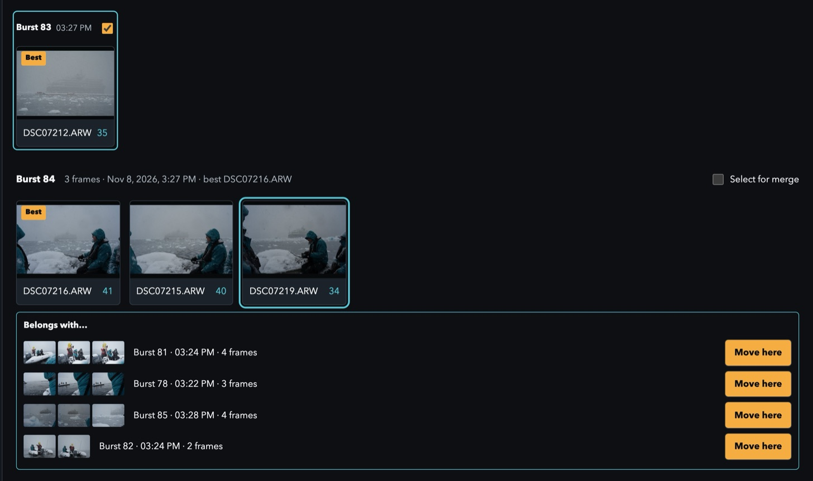

A frame taken a minute after its burst, or of the same subject from a step to
the side, often lands in a burst of its own. Press `B` on it: a panel under
the frame lists up to four bursts from the same camera, shot within 10 minutes
of it, whose frames look most like it, nearest first, each with thumbnails,
its time and size, and **Move here** (`Tab` to it, `Enter` to move). Only
bursts the sheet is showing under the current filters are offered.

The likeness is the macOS Vision image feature print of each preview, kept in
the catalog and never sent to the browser. New imports get one; frames
imported earlier get theirs the first time **Belongs with…** needs them, in
one pass that takes about a second for a trip. Nothing moves unless you choose
it: Lumen never merges by likeness on its own, because how you group a moment
is not something a picture's pixels decide. A moved frame stays in its new
burst through regrouping and re-import, and the burst it left stays together
even if that frame was bridging a time gap.

After updating Lumen from the project folder, run `zsh scripts/bootstrap.sh`
once (add `--no-download` to fetch nothing) so the Vision helper is rebuilt;
until then the panel says so instead of suggesting. The app carries its own
helper, so a new app needs nothing more.

Culling keeps working while an import or ingest runs. It pauses while tagging,
preview refinement, or a stack runs.

## Frame view

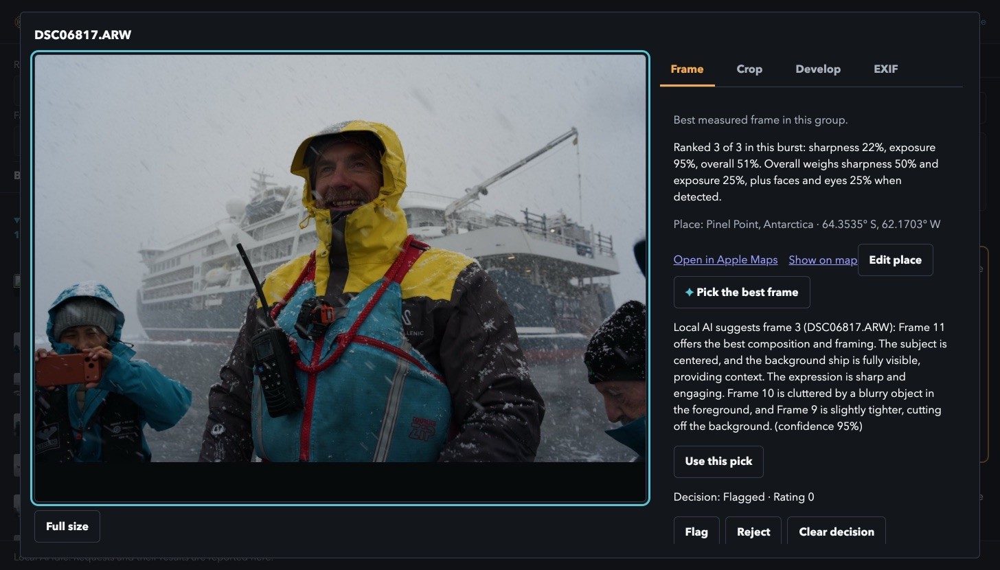

Press `Enter` or `Space` on a focused frame to open it in a dialog over the sheet. The
image fills two thirds of the dialog, fitted so the whole frame shows; **Full
size** (`Z`) swaps in the largest JPEG the camera embedded in the raw (or the
camera JPEG itself, when that is the source) at 1:1
pixels for a sharpness check, and the button names the real pixel size. `[`
and `]`, or the Left and Right arrows, step through the sheet without closing;
at full size, when the image is wider than the view, the arrows pan it instead
and `[` `]` still step. Up and Down pan. `Esc` returns to the frame you started
on.

The right column has four remembered tabs:

- **Frame**: why the frame ranked where it did, its scores, the decision
  buttons, the location line with **Edit place**, keywords with a box to type
  your own (with vocabulary autocomplete), the caption and alt-text fields,
  and the local AI buttons. **Choose as best** is the primary button; **Tag
  this frame** and **Draft a caption** are secondary. **Pick the best frame**
  shows *Burst pick running…* in the panel while the model works, then *ready*
  or *failed: <reason>*; the answer is stored and shown again when the burst is
  reopened. **Use this pick** makes its choice the burst's best frame and moves the frame view to it, with a brief amber ring
  round the image to show the photo changed.
- **Crop**: your own crop, the suggested crops, and **Suggest a crop**, whose
  review is stored and shown again when the frame is reopened.
- **Develop**: adjust the picture itself, described below.
- **EXIF**: camera, lens, focal length, aperture, shutter speed, ISO, exposure
  program, metering, focus mode, flash, white balance, capture time and zone,
  image size, shutter count, firmware, and artist, read from the original each
  time the tab opens (nothing is stored; an offline original says so).

One **Export this frame** button sits in the dialog footer on every tab, using
the Export tab's size and watermark, with **Also export the untouched version**
and **Subfolder named for the capture date** beside it.

Advice calls (burst pick, crop suggestion, develop suggestion, caption, tags)
never block culling: the library is locked only while an answer is written, so
you can keep deciding frames while the model works. Each panel that asked shows
one status line, *<Task> running…*, *<Task> ready* or *<Task> failed: <reason>*,
and the frame dialog states once at the top when the model it needs is not
loaded.

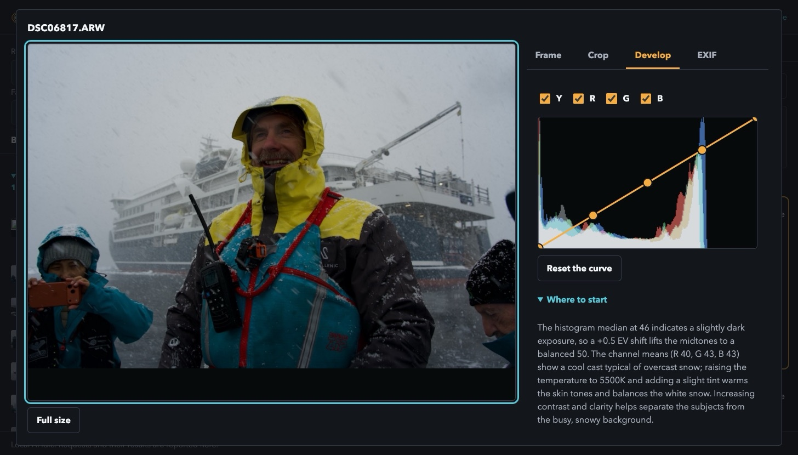

**Develop.** The Develop tab adjusts a raw frame without touching the file.
**Where to start** is for the frame you can see needs help without knowing
which slider: **Suggest settings** sends the current render and its histogram
to the loaded local review model, which parks the handles where it would start
and writes two or three sentences naming what it read in the frame and in the
chart and what each change does about it. Nothing is saved; **Discard the
suggestion** puts every handle back where you left it, and you can keep or
adjust any part of it by hand. If it got something wrong, say so in the box
("too warm", "lost the shadows") and ask again: the next attempt reads the
render it just produced, so it is correcting itself rather than starting over.
The suggestion and its reasoning are stored, so reopening the frame shows them
again with **Park the handles here** to move the sliders back to it. The frame
dialog says so at the top when the review model is not loaded in oMLX.
At the top, a histogram of the current render shares one box with a tone curve;
drag any of its five points, or focus one and nudge it with the arrow keys
(each nudge is announced). Below are sections for Brightness (exposure in
stops), White Balance (temperature and tint), Contrast, Sharpness (sharpness
and clarity, a wide unsharp mask for mid-tone structure), Lens Correction (one
box, disabled when the file carries no profile), and Noise Reduction, which
offers **Auto** (the decoder's own judgement), **Off**, and **Manual** with
luminance and colour amounts. A control the file's decoder does not offer is
disabled with the reason (see [Cameras measured](#cameras-measured)). Every slider has a number box and
its own Reset; **Reset all** and **Reset the curve** undo more at once. A box
that reads "not set" means Lumen is leaving that setting to the camera's own
look, which is different from setting it to its middle value. Your changes
save when you leave the tab or step to another frame, and the frame's tile on
the sheet is re-rendered to match (the Best badge in a burst does not move).
Full size re-renders the raw at its own size rather than swapping in the
camera's embedded JPEG, because sharpness, clarity, and noise reduction act on
single pixels and a render scaled to the window averages them away. Leaving the
tab hands the viewer back whatever it was showing before. **Apply to every
frame in this burst** copies the settings to each raw in the burst, rejected
ones included, as a background job; frames that are not raw or whose original is offline are
skipped and counted. **Export this frame** bakes the settings into the JPEG;
tick **Also export the untouched version** (in the dialog footer or the Export
tab) to get
a second file named `-lumen-original.jpg` beside it. **Reset all**, then leaving the frame, clears the saved settings and returns
the tile to its pre-develop render. Develop is unavailable while the original
is offline, or when the frame is not a raw file, and the tab says which. A profile export (darktable
XMP) cannot be combined with develop settings.

**Your own crop.** Drag on the image to draw a rectangle; the outside dims and
the view switches to the Crop tab, where a **Your crop** card shows the
megapixels it keeps. Drag inside the outline to move it; hold Shift to draw a
new one over it; `Esc` during a drag cancels only the drag. The **Crop lock**
menu (Free, 3:2, 2:3, 1:1, 4:5) is remembered. **Use this crop** saves it like
any crop; the JPEG export honours it and the frame's contact-sheet tile shows
it cropped. A small crop shows the resolution
warning but is yours to keep; only the AI suggestions have an 8 MP floor.

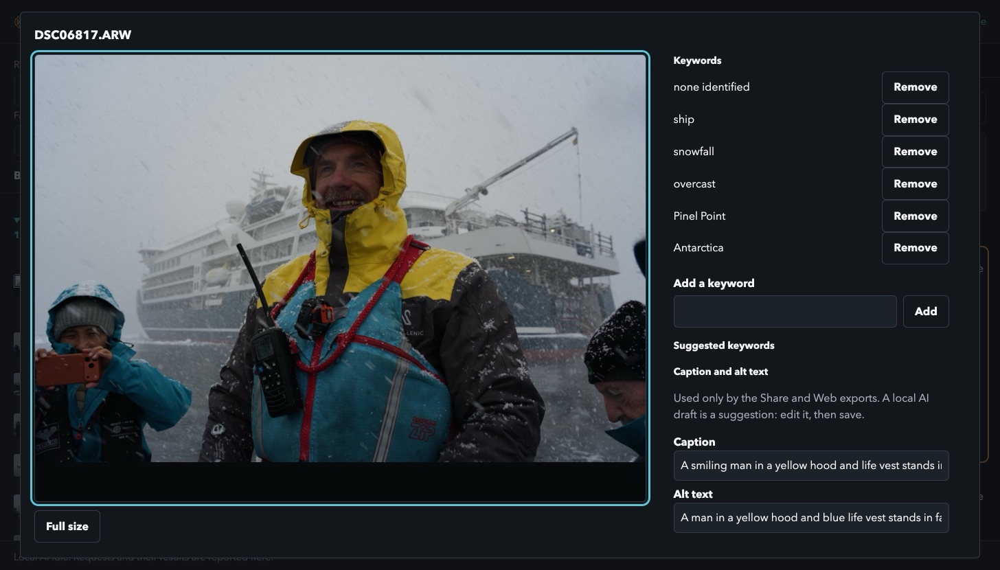

**Keywords.** Type a word and press Enter or **Add**. Your words and the
suggestions you accept are kept in front of the model's words when a frame is
re-tagged; **Remove** drops a typed word and returns an accepted suggestion to
the suggested list. **Forget** in the Assist tab still strips a word from every
frame.

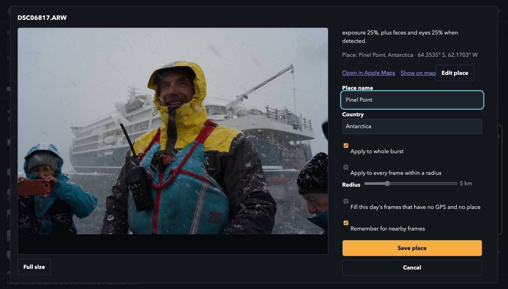

**Place.** **Edit place** opens a small form with the name and country, **Apply
to whole burst** (on by default), and **Remember for nearby frames**, which
adds your name to the local place index so later imports within 25 km resolve
to it without any online lookup. A later correction at the same spot replaces
the remembered name. Remember is disabled on a frame with no GPS fix; **Fill
this day's frames that have no GPS and no place** covers a day shot with the
phone off (see [Places](#places)). On a frame with no GPS, **Add GPS position**
takes coordinates such as `33°55.2'S 18°25.2'E` for the frame, its burst, or
the day; once typed, the button reads **Edit GPS position** so a mistake can be
corrected.

## Filters and paging

Every filter control applies as soon as it changes; there is no Apply button.
The bar holds tag text with Expand, a status choice (**All**, **Keepers**,
**Flagged**, **Unsorted**, **Rejected**), minimum rating, and Reset. **More
filters** folds the date range, camera, **Tagged only**, **Export failed**
(frames whose last export failed; one that later exports drops out) and
**Refine previews** beneath it; it opens itself and shows how many are set
whenever one of them is. **All** hides rejected frames; choose **Rejected** to
review them. The heading shows "N of M frames" while a filter is on, and
carries **Batches** (hides or shows the left rail, remembered per browser),
Tiles, Burst gap, **Jump to selected** and Shortcuts; **Compare marked**
appears once a frame is marked. **Back to top** floats at the foot of the
sheet. The Review model and Fast model selects sit at the top of the rail. The version in the masthead opens **About Lumen** (what is installed, and the data and tool credits). One-frame bursts sit side by side like tiles with a one-line header.
The heading and filter bar stay pinned under the tabs while the sheet scrolls;
on a phone-width window they scroll with it. Clicking the open tab again (Add
photos, Review, …) folds its panel away, and a further click brings it back. Filters live in the page URL, so a reload or
bookmark keeps them. Frames are grouped by capture day and shown 200 at a time;
the button after the last frame shows the next page. Separate tag-text terms
with `|` to match any of them (`heron | egret`). **Expand search** asks
the fast model for related keywords and fills the text filter with them as `|`
terms. `groups` and `refine-previews` take the same
filters:

```sh
uv run lumen groups --from 2026-10-21 --to 2026-10-22 --camera ILCE-7M4:123 --min-rating 3 --json
uv run lumen groups --keepers --tagged --text heron --json
```

## Places

Every frame with a GPS fix gets a place name and country, resolved on import
and backfilled for earlier frames on the next import: "Madikwe Game Reserve,
South Africa" or "Neko Harbour, Antarctica". Protected areas, parks, islands,
bays, and other landmarks within 25 km win over towns; past that the frame view
says "near <town>" (populated places within 200 km, then any feature within
500 km for open sea). The place shows in the frame view beside the coordinates,
the tag-text filter searches it, and tag and caption prompts, keywords (a
`places` vocabulary category), and day digests use it.

**Edit place** in the frame view corrects a name the index got wrong, or
supplies one it could not find at all: open sea, a drifting boat, or anywhere
the nearest named feature is hundreds of kilometres off. Type the name and
country, then choose how far the correction reaches:

- the frame alone;
- **Apply to whole burst** (on by default), every frame in the burst;
- **Apply to every frame within a radius**, every frame in the catalog whose
  GPS fix is within the distance set by the 1-20 km slider beside it (5 km by
  default), across bursts and imports. Use it when a whole anchorage or a
  morning's drifting shares one name.
- **Fill this day's frames that have no GPS and no place**, this frame plus
  every frame with the same capture date that has neither a GPS fix nor a
  place name. It never overwrites a name you typed, and works whether or not
  this frame has a fix. Use it for a day shot with the phone's location link
  off. It outranks the burst; the radius outranks it.

Both the radius and **Remember for nearby frames** need a GPS fix on the frame
you are editing and are disabled without one; the name itself can still be set
by hand. Remembering adds the name to the local index at this frame's fix,
where it outranks every looked-up name and survives an index rebuild, so later
imports from the same spot resolve to it offline.

**Add GPS position** appears on frames with no GPS fix. Type a position the way
a map or a ship's display shows it, as decimal degrees (`-33.92, 18.42`) or
degrees and minutes with hemispheres (`33°55.2'S 18°25.2'E`; seconds work too).
It applies to the frame, the whole burst (on by default), or this day's frames
that have no GPS. Frames with a camera fix are never changed. A frame without a
place name is named from the new position; a name you typed is kept. A typed
position stays editable: **Edit GPS position** opens it prefilled, and saving
replaces that same position wherever the chosen scope reaches (and fills frames
with none), leaving other typed spots alone; a looked-up place name follows it. The
position lives in the catalog, never in the original, and Full resolution
exports write it into the JPEG's GPS; Share and Web leave it out as usual.

Names come from a local GeoNames index built from the `.txt` files in
`vendor/data/geonames/` (or `LUMEN_GEONAMES_DIR`) into
`<library>/cache/geonames.sqlite`; it rebuilds itself when those files change
(the `.zip` archives beside them are ignored). The folder is not in Git;
`zsh scripts/bootstrap.sh` downloads the first two files below and asks for
your country codes (or reads `LUMEN_GEONAMES_COUNTRIES="ZA AQ"`). Re-run it
with a new code before a trip. By hand, the files come from
<https://download.geonames.org/export/dump/>:

- `countryInfo.txt`, which maps country codes to names (always needed);
- `cities500.zip`, towns of 500+ people worldwide, unzipped to `cities500.txt`;
- one `<CC>.zip` per country you shoot in, unzipped to `<CC>.txt`, for parks,
  reserves, bays, and other landmarks. `AQ.txt` (Antarctica) and `ZA.txt`
  (South Africa) are in place on this Mac; add the next country before the trip.

`lumen doctor --json` reports the folder, feature-file count (`countryInfo.txt`
is not counted), place count, and whether online lookup is on under `geonames`.
Without the folder, frames keep their coordinates and simply have no place.
GeoNames data is CC BY 4.0; keep its `readme.txt` in the folder.

The place is written to the JSON sidecar (`place`, `place_country`), to the XMP
sidecar as `Iptc4xmpCore:Location` and `photoshop:Country`, and to exported
JPEG XMP.

Online lookup is off by default. With `LUMEN_GEOCODE_ONLINE=1` (or `true`,
`yes`), a frame with no local place within 25 km asks OpenStreetMap Nominatim
instead, at most one request per second. Privacy: only then do coordinates leave
the Mac. Each answer is cached into the local index, so later frames nearby
resolve offline without asking again.

## Map

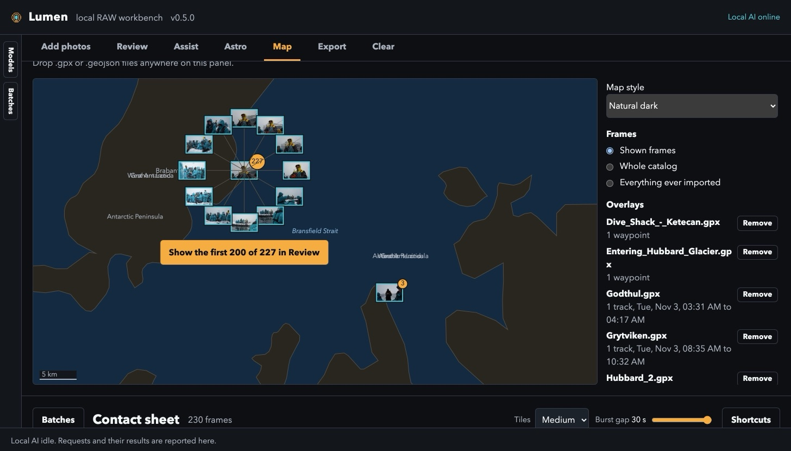

The **Map** tab shows where the frames were taken, offline. Frames with a
position (the camera's fix, a typed one, or one placed from a track) draw over
an eleven-layer Natural Earth base map: coastline, borders, rivers, lakes,
roads, towns, land, seas, terrain regions and peaks. Names appear as you zoom
in; peaks carry their height from zoom 8. The frame view's **Show on map** link
opens the tab centred on that frame, and the frame dialog names the terrain
round a fix after its place.

- **Frames** picks what is drawn. *Shown frames* follows the Review filters,
  *Whole catalog* shows everything, and *Everything ever imported* adds frames
  cleared in earlier sessions (read from the trash snapshots, including
  rejects) as hollow dots; clicking one opens a card with its thumbnail, time,
  place, decision and rating and says to import its folder again with Include
  cleared to work on it.
- Frames that crowd become a cluster with a count. From zoom 9 a cluster shows
  its best frame as a thumbnail. Click a cluster to fan up to 12 of its frames
  out on a ring (flagged first, then by rating and time, rejects last);
  **Show all n in Review** narrows the Review filter to exactly those frames.
  Double-click zooms into a cluster. Clicking a frame opens it, narrowing
  Review to that day if the frame is off the sheet.
- **Frames in view** lists the drawn frames in the same order for the keyboard
  and screen readers. On the canvas, arrow keys pan, `+` and `-` zoom, `0` fits
  every frame, Enter opens the selected frame (else whatever sits nearest the
  centre), and Escape folds a ring or closes a card.
- **Map style** offers Workbench (the charcoal look), Natural dark and Natural
  light, remembered per browser. Frames, clusters and tracks keep their colours
  in all three.

**Overlays.** Drop `.gpx` or `.geojson` files anywhere on the panel, or use
**Add GPX or GeoJSON**, and they draw with their waypoints; each is listed with
its day and time span and a **Remove** button. The files live in
`<library>/map/overlays/`, so copying them there by hand works too. A file that
cannot be indexed is listed with its error.

**Place frames on a track.** Choose a track, and the panel reports how many of
the frames without a fix would be placed and how many fall outside the track's
times. Lumen interpolates a position between the two track points around each
capture time, up to **Max gap** minutes apart (1 to 120, default 10), using the
**Camera clock offset** it reads from the frames (else the Mac's zone) and
shows for you to correct. **Place frames** writes them as typed positions; a
camera fix is never touched, and a position typed earlier is replaced only with
**Replace positions typed earlier** ticked. The placed frames then resolve to a
place name like any typed position.

**Detail for one area.** The base map has no park boundaries or minor roads,
and its 1:10m coastline loses bays narrower than about a kilometre.
`uv run lumen map-region <name> --bbox S,W,N,E` fetches parks, roads, water and
the coastline for one bounding box (at most 4 square degrees) from OpenStreetMap's Overpass
API into `<library>/map/regions/`. This is the only part of the map that goes
online, and only when you run it; `lumen serve` never does.

**Data and index.** `zsh scripts/bootstrap.sh` fetches the eleven layers (about
100 MB) into `vendor/data/map/` (`LUMEN_MAP_DIR`) at a pinned commit with
SHA-256s; Lumen indexes them with every region and overlay into
`<library>/cache/map.sqlite` the first time the tab is opened (a few seconds)
and reparses only files that changed. `lumen doctor` reports the layers it
found under `map`. Without the folder the tab still draws frames and tracks,
over nothing. Natural Earth data is public domain.

## Local AI

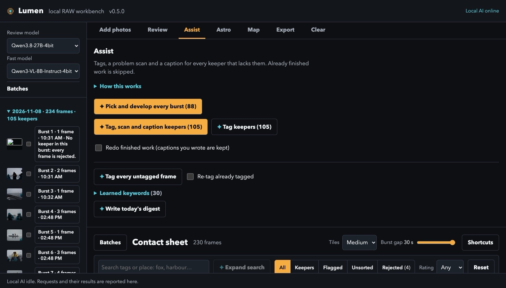

The same buttons work on all three AI engines: **This Mac** (your local oMLX
server, the default, and the only one that needs no connection), **Base**
(your own model server at home) and **Online** (a service you hold a key
for). The **AI engine** select at the top of the left rail switches between
them; see [Settings and the AI engine](#settings-and-the-ai-engine) for what
each one is sent. This section describes This Mac. Everything below is
advisory on every engine: the
models tag, suggest, draft, and explain, but never pick, reject, crop, export,
or delete. Two model roles are used:

| Role | Env var | Default | Used for |
|------|---------|---------|----------|
| fast | `LUMEN_OMLX_FAST_MODEL` | `Qwen3-VL-8B-Instruct-4bit` | tags, problem scan, astro triage |
| review | `LUMEN_OMLX_REVIEW_MODEL` (optional; see below) | `Qwen3.8-27B-4bit` when loaded, else the fast model | burst critique, captions, digests, composition advice, develop suggestions |

Every action checks oMLX's live status first and refuses with a message naming
the unloaded model; the UI disables the matching buttons and says why once, in
the footer strip (and at the top of the frame dialog). Every AI button carries
the same ✦ marker and reads as a verb and its object.
Trust `lumen doctor` (`omlx_roles`) over the configured names.

### Choosing the models

The 8B is fast; the 27B reads a frame more closely. Neither wins outright, so
Lumen lets you switch each role between them instead of fixing one:

- At startup, `lumen serve` puts the review role on the 27B if oMLX has it
  loaded, and on the 8B if it does not.
- The **Review model** dropdown at the top of the left rail switches the running server
  between the two. An unloaded model is marked "(not loaded)". The choice is
  not saved: a restart picks again by the rule above. Run the same caption or
  **Where to start** on a frame, flip the dropdown, and run it again to compare.
- The **Fast model** dropdown beside it does the same for tagging, the reject
  scan and astro triage. It starts on the 8B every time; pick the 27B before a
  tag run when you want its fuller descriptions and can wait about three times
  as long per frame.
- Setting `LUMEN_OMLX_REVIEW_MODEL` on the server process pins the review role
  and skips the startup check. Leave it unset if you want the dropdown's
  default to follow what oMLX has loaded.

What to expect from each, measured on real frames (the tables are in
[MODELS.md](MODELS.md#speed-and-accuracy-on-real-frames-21-to-28-october-2026)):

- The 8B is good enough for captions, burst picks, and a develop starting
  point you will adjust, at a few seconds a frame. Its tag description is one
  plain sentence and it sometimes names species that are not in the frame.
- The 27B gives bolder, frame-specific develop advice at about 13 s, and tag
  descriptions that place the subject and name the light, the background, and
  secondary animals, at 9 to 11 s a frame against the 8B's 3 s.
- Running only the 8B frees about 16 GB, and is the whole setup on a 16 GB
  Mac. The 27B is worth loading on a machine with room for it, and once loaded
  it serves whatever else you use oMLX for, such as its chat.

The practical rule: tag a day with the 8B, then switch the **Fast model**
dropdown to the 27B and re-tag the keepers with `--retag` when you want the
fuller descriptions.

`zsh scripts/bootstrap.sh` offers to install oMLX 0.7.2 into `/Applications`
on macOS 15 or newer (open it once so it installs its `omlx` command), then
offers both models into oMLX's `model_dir` from `~/.omlx/settings.json`, or
`~/Models` before oMLX has written one. It shows the memory the Mac reports:
the 8B defaults to yes, the 27B to yes only from 32 GB. A model folder that
already holds `config.json` and weights is left alone.

With the app there is no script: install oMLX from its own site, open it, and
download the models in it. Settings names them under AI engine: the 8B is
needed for every AI feature, and the 27B is worth adding from 32 GB of memory.

#### On a 16 GB Mac

Tried on a 16 GB M4 Mac mini on 2026-11-23:

- Take the 8B only; the 27B wants 32 GB or more. Close other apps before
  loading it.
- oMLX refused to load the 8B with its memory guard on `safe` ("does not fit
  under the dynamic memory ceiling") and loaded it on `balanced`. The setting
  is in oMLX's admin page.
- oMLX then suggests `sudo sysctl iogpu.wired_limit_mb=13312`. That is a
  Terminal command needing an administrator password, and it resets on
  restart; treat it as optional. Whether advice runs acceptably without it has
  not been measured.

Start oMLX, then tag:

```sh
omlx start
uv run lumen tag --photo 1
uv run lumen tag --keepers           # frames that are flagged or best and not rejected
uv run lumen tag --all
uv run lumen tag --keepers --retag   # also re-tag already tagged frames
```

Tagging skips frames that already have a description unless `--retag` is
given. Keywords come from `<library>/vocabulary.json`, copied once from the
packaged starter and then yours to edit; confident model words are added back
to it so the vocabulary grows with your shoots. In the UI the **Assist** tab has
**Tag keepers (N)** and, below it, **Tag every untagged frame** with a
**Re-tag already tagged** toggle. The frame view offers **Tag this frame** for
one frame and a keyword box for words of your own (they are kept through re-tagging), with suggested keywords you can add or remove; adding a suggested
species teaches it to the vocabulary as wildlife. The **Learned keywords**
panel in the **Assist** tab lists the words the models added, and **Forget**
removes a word from every frame and stops it being learned again.

Run the whole assist in one job (tags, problem scan, caption; finished work is
skipped, a failing step is logged and the next still runs):

```sh
uv run lumen assist --keepers        # or --all
```

The UI button is **Tag, scan and caption keepers (N)** in the Assist tab.

**Pick and develop every burst (N)**, above it, runs one job over every burst
on the review model: the model names the best frame of the burst, that frame
becomes the pick, and the model then suggests develop settings for it, which
are saved as that frame's develop, so the contact sheet shows it developed;
**Reset all** on its Develop tab undoes it. A burst whose every frame is
rejected is skipped and a lone keeper is its own pick and is developed the
same way. Bursts already picked and advised are not asked again unless
**Redo finished work** is ticked, and a rerun never undoes a frame you chose
by hand, never overwrites settings a frame already has, and never redoes a
develop you saved or reset after the suggestion. Nothing is exported. A
failing burst is logged and the next still runs.

The other model actions, each also available from the UI:

```sh
uv run lumen review-rejects --keepers   # Review tab: Scan keepers for problems
uv run lumen critique 12                # frame view: Pick the best frame
uv run lumen caption 42                 # frame view: Draft a caption
uv run lumen digest 2026-10-23          # Assist tab: Write today's digest → <library>/digests/
uv run lumen triage 12                  # Astro tab: Triage lights
```

Suggested rejects appear in the **Review** tab for you to confirm or dismiss;
nothing is rejected until you say so. A caption is a draft until you save it,
and a caption you wrote is never replaced. Captions and alt text are used only
by the Share export preset.

Lumen reads the local oMLX API key from `LUMEN_OMLX_API_KEY`, or from the local
`~/.omlx/settings.json` written by oMLX. It rejects non-loopback model URLs.
Override the defaults only when needed:

```sh
export LUMEN_OMLX_URL="http://127.0.0.1:8000"
export LUMEN_OMLX_MODEL="Qwen3.8-27B-4bit"
export LUMEN_OMLX_FAST_MODEL="Qwen3-VL-8B-Instruct-4bit"
```

Tagging sends the vocabulary as a stable system prefix so oMLX can cache it.
oMLX's default settings (`hot_cache_only: true`, `hot_cache_max_size: "0"`)
cache nothing; set `hot_cache_only: false` and a real `hot_cache_max_size` in
`~/.omlx/settings.json` and restart oMLX. Measured so far, only text-only
requests reuse the prefix: a request that carries an image goes through oMLX's
separate vision cache and reports no cached tokens, so tagging gains nothing
yet. The layout costs nothing and will pay off if oMLX adds prefix caching for
vision requests. One trap: oMLX answers a repeated identical request from
cache in under a second, so a re-run on the same frames is not a speed test.

Species names are not checked against ground truth by either model; both have
named a second species for one bird, and the 8B has listed species on a frame
with no animal. Treat species as a suggestion to confirm, not a fact.

See [MODELS.md](MODELS.md) for what was validated on this Mac and the measured
timings behind the tables above, and `model-speed/HANDOFF.md` for the raw
results and the ideas not yet tried.

## Settings and the AI engine

**Settings** is the gear button at the far right of the tab row. It opens in
place of the workflow panel, with four sections down its left side: AI engine,
Library, Places and map, and Server. Each section has its own **Save** and
**Discard**; nothing changes until you save, and each row says when a change
applies. A setting fixed by a shell variable (`LUMEN_NEAR_DUP_DISTANCE`,
`LUMEN_GEOCODE_ONLINE`) is shown read-only with the variable's name. Saved
settings are kept in the catalog and apply to the command line too. The Server
section shows the address, the version, and whether the running server is out
of date; it changes nothing.

### Where the advice runs

The AI engine section, and the **AI engine** select at the top of the left
rail, choose one of three engines for all advice:

- **This Mac** (the default): oMLX on this Mac, as described in
  [Local AI](#local-ai). No advice request leaves the Mac.
- **Base**: your own model server elsewhere on your network, at an `http` or
  `https` address, with an optional key.
- **Online**: an online service you hold a key for, at an `https` address.

Any server that speaks the standard chat completions API works. Type the
service's API address as its documentation gives it, path included; a bare
host gets `/v1`. Keys are kept in the macOS Keychain (service `Lumen`), never
shown again, and never sent to the page. **Test** saves the address and asks
the engine for its models; the Fast model and Review model fields offer what
it found, or take a typed name when the service lists none. Switching to an
engine that does not answer is refused and nothing is saved, and so is a
switch while a batch is still running. While Base or Online is in use, the
header status line begins "AI: Base" or "AI: Online", followed by the
session's tokens once it has made calls. A saved key belongs to the address it
was saved for: moving that engine to another host is refused until you
replace the key. To change service, press **Replace**, paste the new service's
key, then save the new address; a key replaced since Lumen started may follow
one change of address.

In the AI engine section, **Base setup** and **Online setup** fold away under
the engine choice, one open at a time. The chosen engine's setup opens by
itself; open the other to set it up without switching to it.

The Online form's **Service** select fills in a documented address; **Other**
leaves it for typing, and the address stays an ordinary field. The Base hint
gives the usual addresses of two home model servers.

| Engine | Service or program | Address |
|--------|--------------------|---------|
| Online | Anthropic | `https://api.anthropic.com/v1` (the service describes this chat-compatible address as a testing and comparison path; its native API is the supported one). Its model list is not readable through this address, so type the Fast model and Review model names from the service's documentation |
| Online | Google | `https://generativelanguage.googleapis.com/v1beta/openai` |
| Online | OpenAI | `https://api.openai.com/v1` |
| Online | Qwen (Alibaba Cloud) | no preset: choose **Other** and paste your workspace's address, `https://<WorkspaceId>.<region>.maas.aliyuncs.com/compatible-mode/v1`, from the service's console |
| Base | Ollama | `http://<your PC>:11434/v1` |
| Base | LM Studio | `http://<your PC>:1234/v1` |

### Online services tried

| Service | Date | Fast model | Review model | Result |
|---------|------|------------|--------------|--------|
| Anthropic | 2026-11-21 | `claude-haiku-5-5` | `claude-sonnet-5-5` | Both worked through the address above and felt very fast to the photographer; no timings were recorded. Test passes with an empty model list, so the names are typed. |

The other services in the table above have not been tried yet.

### Setting up a Base server

Lumen's prompts ask for a short, structured answer, so a model that reasons
before it answers only costs time. Turn the model's reasoning (thinking) off
in the server program's own settings for that model.

Measured on 2026-11-21 against LM Studio on one home PC (Ryzen 9 9950X3D,
Radeon RX 9070 XT, 64 GB of memory), with the same review model this Mac
runs, picking the best frame of a burst:

| Where | Reasoning | Burst pick |
|-------|-----------|------------|
| Base | on | about 58 s (4 frames): 690 of the 783 tokens written were reasoning |
| Base | off | 14 s (3 frames) |
| This Mac | off | 8 s (3 frames) |

Tagging one frame with the fast model took 15 s on that PC while the review
model was loaded beside it, and a second or two (by the photographer's watch)
once the fast model had the graphics card to itself, against about 3 s on this
Mac. The card has 16 GB: the fast model fits with room to spare, the review
model does not, and the two cannot share it. So a home PC can out-tag this Mac
and still be slower at picks and captions; either way it leaves the Mac free,
cool and on battery while a batch runs.

- Load one model at a time unless both fit in the graphics card's memory.
  When a model spills over, everything on the card slows down. On a card this
  size, pointing both the Fast model and the Review model at the fast model
  keeps every call quick.
- Lumen asks Base not to reason, the same request it makes of this Mac, but a
  server may ignore it. Whether LM Studio honours it has not been tested, so
  set it in the program as well.
- Lumen allows Base and Online 4000 tokens beyond each answer's usual limit,
  so a reasoning model can still finish. If one runs out anyway, the message
  is "Base model spent its token budget on reasoning and returned no answer".
- A call is abandoned after 240 seconds. A reasoning model on a long burst can
  reach that.
- If a small model writes more slowly than a large one on the same PC, it is
  probably not fully on the graphics card: check the program's GPU offload
  setting for that model.
- The server program's log shows each request with its timings and
  `reasoning_tokens`. It is the quickest way to see where the time goes.
- With reasoning off, the one rationale seen was vaguer than with it on. The
  pick is what was measured (on this Mac, three right out of three); watch
  whether the picks still agree with your eye.

### What leaves the Mac

On Base and Online, and only there, each request sends:

- the preview the advice needs, resized to at most 1024 px on the long edge and
  re-encoded with no metadata (no EXIF, GPS position or serial number);
- the prompt, which can carry the frame's place name, your keyword
  vocabulary, develop settings and a summary of the histogram, and the words
  you type as feedback on a develop suggestion;
- for **Expand search**, the words you typed, with your keyword vocabulary;
- for the day digest, the day's date, its counts (frames, keepers, rejects,
  bursts, astro jobs), its keywords and place names, and the top frames' file
  names, scores and burst numbers;
- for a stack review, the debrief's text (what happened, what to try now,
  next time's settings) with the stacked preview.

Never sent: camera originals, source paths, fingerprints, GPS coordinates, and
oMLX's own key. The Base and Online keys go only to their own engine.
(Looking up missing place names online, in Places and map, is a separate
setting that sends a frame's coordinates to the place lookup service.)

Online services charge for tokens. Lumen counts the tokens each engine
reports for the running server, shown as "Tokens this session" in the AI
engine section with the input and output tokens and the number of calls (one
total per engine, not per model; the service's own console is where cost is
shown); a reply that reports none is counted as "not reported", and
the count starts again when the server restarts.

Batches ask first. On Base or Online, tagging, Tag, scan and caption, Pick and
develop every burst, the problem scan and sky triage say "This sends N frames
to Online. Continue?" before they start; the command-line `tag`, `assist`,
`review-rejects` and `triage` print the count and need `--yes`. Advice on one
frame or one burst runs without asking; the status line is the notice.

## Finish and clear a shoot

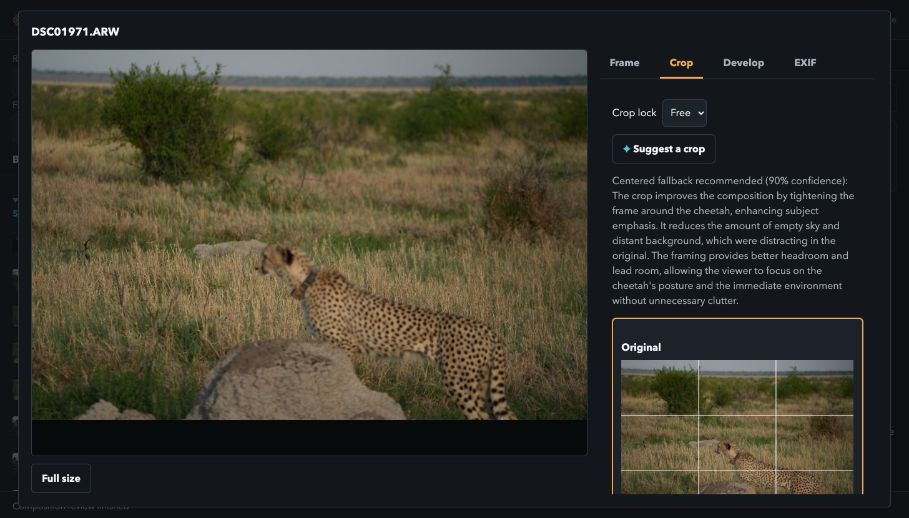

In the contact sheet, select a frame (or select its batch in the left rail),
press Enter on it to open the frame view, and use the **Crop** tab (see
[Frame view](#frame-view) for drawing your own). Lumen uses Apple Vision face
rectangles and attention saliency as approximate evidence for subject-safe crop
choices. When that evidence is absent or weak, it says so and offers only the
original plus a centered fallback. Suggested crops below 8 MP are not offered;
any choice below 12 MP shows the exact remaining-resolution warning.

Crop previews include thirds lines. **Use this crop** stores normalized
coordinates in Lumen's catalog and JSON/XMP sidecars; **Keep original** clears
the active crop while preserving provenance. The RAW is never changed.
**Suggest a crop** lets the configured oMLX vision model recommend one of the existing
safe choices and explain why. That advice is optional and never selects a crop
for you, so manual choices still work when oMLX is unavailable. Lumen applies
an approved crop to the full-resolution developed image only during JPEG
export; the contact-sheet tile shows the same crop, so the sheet matches what
export will write.

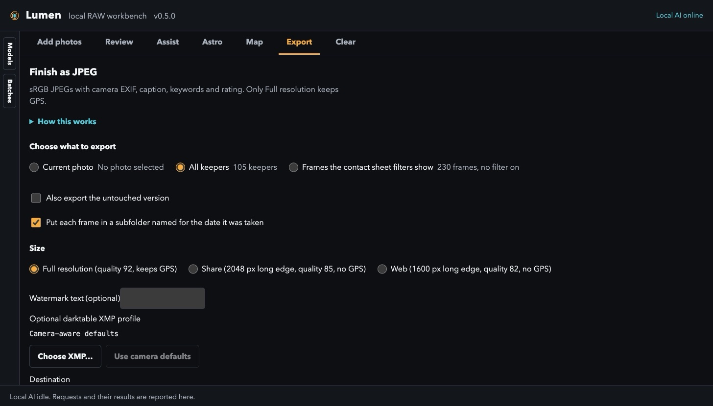

Next use the **Export** tab. Choose **Current photo**, **All keepers**, or
**Frames the contact sheet filters show**, which exports exactly what the
filter bar matches (all of it, not only the page on screen) as a cancellable
job. When frames fail, tick **Export failed** and export the filtered frames to
retry just those. Each job's reasons are in
`<library>/outputs/jobs/<id>/job.log`; a failure with under 1 GB free on the
library's disk says the disk is full, since each raw needs a full-size working
render there. A keeper is any frame that is not rejected and is either
flagged or the best frame in its burst, so a single frame stays a keeper unless
you reject it. **Flagged** means marked to keep with F, **Unsorted** no
decision yet, and **Tagged** described with keywords by the local AI. Pick a
preset: **Full resolution** exports at full available
resolution, quality 92, sRGB; **Share** resizes to a 2048 px long edge at
quality 85; **Web** resizes to a 1600 px long edge at quality 82. Capture
time, camera/lens details, copyright, ratings, descriptions, and keywords are
retained when available. Full keeps GPS location; Share and Web drop it. One
`exiftool` pass over the finished JPEG copies the camera's MakerNote from the
original (the renderers write none of their own) and writes the description and
keywords as IPTC IIM `Caption-Abstract` and `Keywords` in UTF-8, which agency
ingests and Photo Mechanic read in preference to XMP. `exiftool` is therefore
required for every export, raw or not.

A camera JPEG never passes through a renderer. **Full resolution** with no
crop and no watermark is lossless: the file's own bytes are the export and the
caption, keywords, rating, place, and Lumen's export record go in through
`exiftool`, so the pixels are exactly what the camera wrote (the export record
says `lossless` in place of a quality). A crop or watermark means one
re-encode, at the camera's own quantization tables and chroma subsampling
rather than quality 92; Share and Web use their usual sizes and qualities. A
body set to AdobeRGB is refused by name, since the export promises sRGB; set
the body to sRGB or shoot raw. PNG, TIFF, and HEIC sources still render
through darktable.
**Watermark text** (optional, up to 80 characters) is drawn bottom-right. The
browser remembers the preset and the watermark.

**Choose XMP…** opens the macOS file picker for an existing `.xmp` processing
profile. The browser remembers your explicit selection for the next export.
**Use camera defaults** clears it. Lumen never automatically selects an XMP
beside an original. If a remembered file has moved, choose it again or use
camera defaults.

**Put each frame in a subfolder named for the date it was taken** is on by
default: the JPEG lands in `<library>/outputs/jpeg/<Mon-DD-YYYY>/`, dated from
the capture time stored for the frame, so one export spanning several days
splits into one folder per day. A frame the camera dated nowhere goes to
`Unknown-Date/`. Untick it to write straight into `jpeg/`.

The panel shows the managed destination and every successful output's exact
path. **Show outputs in Finder** opens only `<library>/outputs/jpeg/`, whose
default location is `~/Pictures/Lumen Library/outputs/jpeg/`. Filenames such as
`photo-lumen.jpg`, `photo-lumen-1.jpg`, and `photo-lumen-2.jpg` avoid overwriting
earlier exports. A keepers export runs as a background job with a progress
dialog and a **Cancel export** button; cancelling keeps the JPEGs already
written. Partial failures keep successful JPEGs and report each failed
photo so you can resolve the problem and retry that photo.

Equivalent CLI commands:

```sh
uv run lumen export --photo 42 --profile "/path/to/sony-high-iso.xmp" --json
uv run lumen export --keepers --json
uv run lumen export --keepers --preset share --json
uv run lumen export --keepers --preset web --watermark "© Your Name" --json
```

Raw frames are rendered by a small native helper that `scripts/bootstrap.sh`
builds (the app carries its own); if it is missing, exporting a raw without a darktable profile is refused
with a message telling you to run the script again. If `darktable-cli` is
unavailable, raws and camera JPEGs still export; an export that uses a
darktable profile, or starts from a PNG, TIFF or HEIC, is refused with a
message saying how to add darktable, and the profile chooser is disabled. In
the app, tick darktable in Lumen > Set Up Lumen… and reload the page. Otherwise install
darktable as described in the README, add its executable directory to `PATH` if needed, restart Lumen, and reload the page. Check with
`uv run lumen doctor --json`. Import and review remain usable.

## Refine previews

Import shows the camera's small embedded JPEG. **Refine previews** (under the
contact sheet's **More filters** fold) re-renders frames from the RAW with darktable at 2048 px,
then re-measures sharpness, exposure, astro, and face/eye signals and re-ranks
each affected burst. Choose the scope — the selected burst, the frames matching
the current filters, or the whole catalog — and follow progress in the footer
strip; refined frames carry a **Refined** mark. From the CLI:

```sh
uv run lumen refine-previews --group 3
uv run lumen refine-previews --keepers --from 2026-10-21
uv run lumen refine-previews --all
```

It needs `darktable-cli`; without it the control is disabled with the reason.
Refining never changes a manual pick, decision, or rating, and never touches the
original. Frames whose original changed since import are skipped and logged.

## Stack a night sky

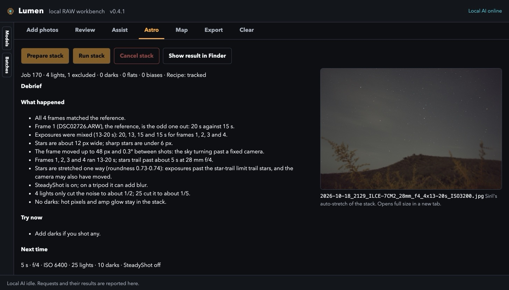

The **Astro** tab turns the selected batch into one managed Siril stack. Lumen
never changes the originals: it links the chosen lights into
`<library>/outputs/astro/<job-id>/`, writes a fixed `stack.ssf` script plus a
`manifest.json` that records every frame's size, modification time, and SHA-256,
and runs the vendored or installed `siril-cli` with that folder as its only
working directory.

1. Select a frame from the night's batch and open **Astro**. Every light in the
   batch is listed with a checkbox; untick frames with trails or clouds. At
   least two lights must remain.
2. Optionally choose dark, flat, and bias folders with the macOS folder picker.
   Folders are read non-recursively; missing, empty, or single-frame sets add a
   warning but never block the stack (Siril 1.4 cannot build a sequence from one
   frame). Warnings always start with the word *Warning*, so they do not rely on
   colour.
3. Choose a **Recipe**: **Tracked** (global star alignment, the default) or
   **Untracked wide-field** (two-pass alignment that keeps only the area common
   to every frame, for untracked tripod shots). The CLI takes
   `--recipe tracked|untracked`.
4. Choose **Where you shot**: Dark site, City or light pollution, Ship or
   boat, or Handheld. It changes only the debrief's advice (ship and handheld cap the
   exposure and suggest the Untracked recipe), never the stack, and the browser
   remembers it.
5. Tick the confirmation checkbox, then **Prepare stack**. The panel shows the
   job number, counts of lights, excluded lights, and calibration frames, the
   warnings, and the managed manifest and log paths. Nothing runs yet.
6. **Run stack** starts Siril. One heavy job runs at a time; a second run
   returns a clear conflict. Progress is announced and polled only while the job
   is queued or running. **Cancel stack** stops only this job's Siril process and
   can never produce a result.
7. On success the job folder holds the linear 16-bit RGB TIFF (star-aligned,
   sigma rejection, `-rgb_equal`) and `preview.jpg`, Siril's auto-stretch of
   it. Both carry the first light's EXIF and maker notes and are named from
   the EXIF, for example
   `2026-10-18_2129_ILCE-7CM2_28mm_f4_4x15s_ISO3200.tif` (date, time, camera,
   focal length, aperture, count x exposure, ISO; mixed exposures read as a
   range such as `13-20s`). The preview sits beside the debrief and opens full
   size in a new tab; **Show job folder in Finder** selects the TIFF. The TIFF
   is linear and looks dark until stretched in Siril or another editor.
   Provenance (`astro_stacked`) is recorded for every light and in each
   light's sidecar.

### Debrief

After a run that reached Siril, succeeded or failed, the panel shows a
**Debrief** with three parts: **What happened** (registration, rejected frames,
trailing, missing calibration, SteadyShot left on), **Try now** (what to change
on this stack), and **Next time** (exposure, ISO, light and dark counts and
SteadyShot for the place you chose). Lumen's own rules write it from the
frames' EXIF and Siril's log, so it needs no model. A job refused before Siril
launched (an original offline or changed) gets no debrief.

**Look at the stack** asks the local review model for notes on the preview. It
is advice only and never changes the settings.

A job keeps `frames.json` (each light's FITS header plus its EXIF
stabilisation), which the debrief reads. Siril's working `process/` folder,
often several gigabytes, is deleted after the run, but only once
`frames.json` was written. The debrief has no CLI command; the web routes are
`GET /api/astro/jobs/<id>/debrief?place=<dark_site|city|ship|handheld>` and
`POST /api/astro/jobs/<id>/review`.

Failed, cancelled, and interrupted jobs keep their `manifest.json` and
`siril.log` in the job folder so you can review the exact command and Siril
output; the log tail is shown in the panel. If Lumen restarts mid-job the job is
marked *interrupted*; prepare a new one. The browser remembers an active job
number so reloading the page resumes watching it.

Equivalent CLI commands:

```sh
uv run lumen astro prepare 3 --confirm --exclude 41 --darks "/Volumes/CAL/darks" --json
uv run lumen astro run 1 --json       # blocks until the job ends
uv run lumen astro status 1 --json
uv run lumen astro cancel 1 --json
```

While `lumen serve` is running it owns the job runner, so run and cancel jobs
from the web page rather than from a second CLI process. To recover a job's
files, look under `~/Pictures/Lumen Library/outputs/astro/<job-id>/`; the
`lights/` entries there are read-only links to your originals, never copies or
moves.

The separate **Clear** tab states the exact selected-batch and whole-workspace
frame counts. **Remove batch from Lumen** removes the selected batch;
**Clear workspace** requires the exact typed word `CLEAR`. Both retain camera
originals and completed exports. After success, batches reload and the panel
shows exact recovery folder and catalog snapshot paths under
`<library>/trash/<UTC-timestamp>/` (normally
`~/Pictures/Lumen Library/trash/`). Previews, Lumen sidecars, and eligible working
files move there with a pre-cleanup SQLite catalog snapshot. There is no
automatic trash expiry or one-click restore; keep that folder for manual
recovery. Export provenance remains recorded even after its source catalog row
is removed.

**Remove previously cleared frames** lists how many frames in the catalog were
already removed or cleared in an earlier session (for example frames imported
before Lumen skipped them, or ones you re-imported on purpose) and removes them
the same recoverable way; bursts they only partly fill are re-ranked.

```sh
uv run lumen groups --json
uv run lumen remove 7 --json
uv run lumen cleared --json
uv run lumen cleared --remove --json
uv run lumen clear CLEAR --json
```

The numeric argument to `remove` is a group ID from `groups`, not a photo ID.
The web XMP picker and Finder reveal use protected same-origin POST requests.

## Legacy darktable denoising/export hook

Create an XMP in darktable containing the denoise, lens, color, and sharpening
modules you want, then run:

```sh
uv run lumen process 1 \
  --pipeline darktable \
  --profile "/path/to/sony-high-iso.xmp"
```

The result goes to the library's `outputs/` directory. Lumen passes an argument
array directly to `darktable-cli`, records the command/result in provenance, and
never overwrites the RAW file.

## Batch and automation commands

All inspection commands can emit JSON:

```sh
uv run lumen import /path/to/shoot --json
uv run lumen groups --json
uv run lumen doctor --json
```

Override the measured winner at any time; the manual pick survives reimport and
regrouping:

```sh
uv run lumen pick 42
```

For astrophotography automation, place a reviewed Siril `.ssf` script inside the
library `outputs/` directory and run it through the allow-listed hook:

```sh
uv run lumen siril "~/Pictures/Lumen Library/outputs/stack.ssf"
```

The hook refuses scripts outside the managed output directory and reports the
exact argument array in its result. Project-specific stack recipe generation
can be added without weakening that boundary.

These stable boundaries are intended for future launchd jobs, folder watchers,
animal/eye analyzers, similarity grouping, Siril stacking, and additional RAW
processors. The module map is in [ARCHITECTURE.md](ARCHITECTURE.md).

